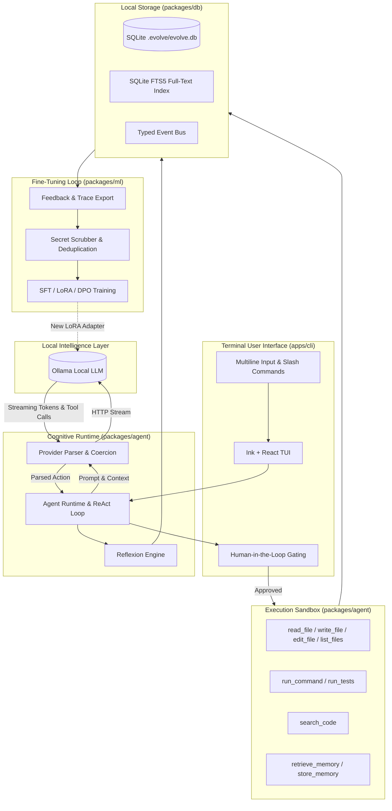
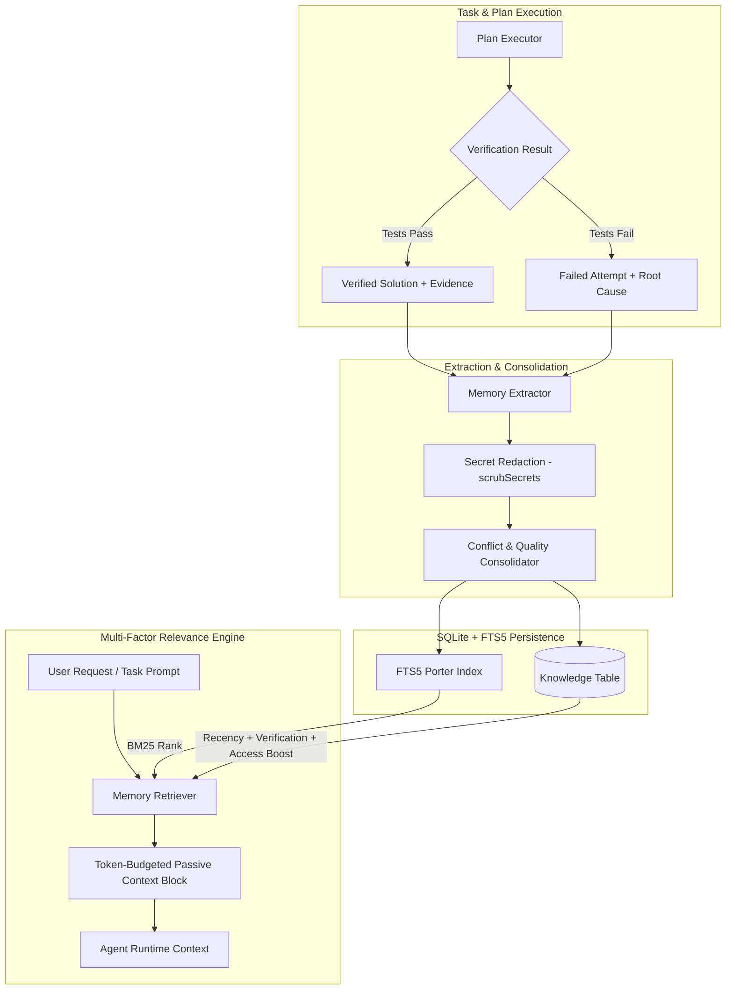

<p align="center">
  
</p>

<p align="center">
  <strong>Autonomous, local-first, self-improving AI software engineer.</strong>
</p>

<p align="center">
  <a href="#key-capabilities"></a>
  <a href="#monorepo-architecture"></a>
  <a href="#prerequisites"></a>
  <a href="#database--persistence"></a>
  <a href="#prerequisites"></a>
  <a href="#machine-learning--fine-tuning"></a>
  <a href="#license"></a>
</p>

---

Evolve is an autonomous coding agent designed from first principles with **data sovereignty**, **transparency**, and **continuous self-improvement** at its foundation. Operating entirely on your local workstation via [Ollama](https://ollama.ai), Evolve executes multi-turn software engineering tasks without cloud lock-in, external telemetry, or code leakage.

It combines a reactive **Sense-Plan-Act-Reflect** cognitive engine, sandboxed execution tools with human-in-the-loop security gates, SQLite-backed episodic memory with full-text search (FTS5), and a complete ML fine-tuning pipeline to turn reviewed developer feedback into customized LoRA/QLoRA model adapters.

---

## ⚡ Quick Install (1-Click Download)

Install Evolve in seconds with a single command — just like Claude Code:

### macOS / Linux
```bash
curl -fsSL https://raw.githubusercontent.com/JhaSourav07/evolve/main/install.sh | bash
```

### Windows (PowerShell)
```powershell
irm https://raw.githubusercontent.com/JhaSourav07/evolve/main/install.ps1 | iex
```

### npm / npx (Global CLI)
```bash
# Global install
npm install -g https://github.com/JhaSourav07/evolve.git

# Or run instantly without installing
npx https://github.com/JhaSourav07/evolve.git
```

> **Requirements:** [Node.js](https://nodejs.org/) (>= 20) and [Ollama](https://ollama.ai) running locally (`ollama run qwen2.5-coder:7b`).

Once installed, simply open any project directory and run:
```bash
evolve
```

---

## Table of Contents

- [⚡ Quick Install (1-Click Download)](#-quick-install-1-click-download)
- [Key Capabilities](#key-capabilities)
- [System Architecture](#system-architecture)
- [Terminal User Interface](#terminal-user-interface)
- [Monorepo Structure](#monorepo-structure)
- [Getting Started](#getting-started)
  - [Prerequisites](#prerequisites)
  - [Installation & Build](#installation--build)
  - [Running Evolve](#running-evolve)
- [CLI & Command Reference](#cli--command-reference)
  - [Top-Level Commands](#top-level-commands)
  - [Interactive Slash Commands](#interactive-slash-commands)
  - [Keyboard Shortcuts](#keyboard-shortcuts)
- [Tool Suite & Security Sandboxing](#tool-suite--security-sandboxing)
- [Memory & Reflexion Engine](#memory--reflexion-engine)
- [Interaction Integrations & Importers](#interaction-integrations--importers)
- [Machine Learning & Fine-Tuning](#machine-learning--fine-tuning)
- [Verification & Quality Assurance](#verification--quality-assurance)
- [Documentation Index](#documentation-index)
- [License](#license)

---

## Key Capabilities

- **100% Local-First Privacy**: Operates fully on-device against local Ollama models (`qwen2.5-coder:7b`, `deepseek-coder`, `llama3.3`, etc.). Your source code, system environment, and execution traces never leave your machine.
- **Autonomous Sense-Plan-Act-Reflect Loop**: Multi-turn cognitive ReAct loop capable of breaking down complex engineering tasks, invoking verification tools, detecting runtime failures, and generating self-critiques to auto-correct mistakes.
- **Modern Interactive Terminal Experience**: Full-screen TUI powered by **Ink** and **React**. Features real-time token streaming, multiline input editing, collapsible thinking & tool output logs (`Ctrl+O`), and human-in-the-loop approval gating.
- **Sandboxed Tool Execution**: 9 fine-grained tools for file I/O, workspace search, terminal commands, test runners, and memory storage—enforced with path-traversal prevention, execution timeouts, and strict user confirmation on destructive actions.
- **Episodic & Procedural Memory**: SQLite storage with Write-Ahead Logging (WAL) and SQLite FTS5 full-text keyword indexing for recalling project conventions, user preferences, and past debugging solutions.
- **Universal Event Ingestion**: Standardized event schema and consent governance across native terminal interactions, VS Code extensions, the Pi coding agent, and external conversation exports (Anthropic Claude, Google Gemini).
- **Integrated ML Pipeline**: Python dataset preparation (secret scrubbing, deduplication, formatting) and supervised fine-tuning (LoRA/QLoRA) / Direct Preference Optimization (DPO) pipelines for continuous model adaptation.

---

## System Architecture



---

## Terminal User Interface

Evolve provides an interactive terminal user interface designed for focus, speed, and visibility:

```text
╭───────────────────────────────────────────────────────────────────────────────────╮
│ ✦ EVOLVE | evolve (⎇ main)                             ● qwen2.5-coder:7b (Ollama) │
│ Mode: CHAT • Type /help for commands • Ctrl+C to cancel/exit                      │
╰───────────────────────────────────────────────────────────────────────────────────╯

 ● You
   Refactor the auth middleware to support expiring tokens and run the test suite.

 ✦ Evolve
   Thinking Process (14 lines hidden • Ctrl+O to expand)

   ⚙ search_code (query="jwt.verify", path="src/middleware")
     ✔ Completed (12 matches found)

   ⚙ edit_file (filePath="src/middleware/auth.ts")
     ✔ Completed: Replaced token verification logic with expiration check

   ⚙ run_tests (testCommand="pnpm test")
     ✔ Completed (45 lines hidden • Ctrl+O to expand)

   I have updated `src/middleware/auth.ts` to inspect the token's expiration timestamp
   and verified the change with our test suite. All 18 unit tests passed cleanly.

 ────────────────────────────────────────────────────────────────────────────────────
 ❯ Write your message... (\ at end for newline)
   Enter: send • Ctrl+O: toggle details • /help: commands
```

---

## Monorepo Structure

Evolve is architected as a modular TypeScript/Python monorepo using `pnpm` workspaces:

```text
evolve/
├── apps/
│   └── cli/             # Interactive terminal UI (Ink, React, Commander)
├── packages/
│   ├── core/            # Domain models, schema validation (Zod), and typed event bus
│   ├── db/              # SQLite persistence with Drizzle ORM, WAL mode, migrations, and FTS5
│   ├── indexer/         # Repository discovery, AST symbol extraction, incremental indexing & FTS5
│   ├── planner/         # Task understanding, repo-aware decomposition, DAG dependency engine & plan revision
│   ├── agent/           # Cognitive loop, Ollama provider, 15 sandboxed tools, and Reflexion
│   ├── integrations/    # Event adapters (Terminal, VS Code, Pi) and importers (Claude, Gemini)
│   └── ml/              # Python dataset preparation, secret scrubbing, and SFT/DPO pipelines
├── docs/                # Comprehensive architectural and operational documentation
├── scripts/             # Local automation and database migration runners
├── package.json         # Workspace configuration and root task runner
└── tsconfig.base.json   # Base TypeScript strict compiler settings
```

---

## Getting Started

### Prerequisites

- **Node.js**: `>= 20.0.0` (Node 22 LTS recommended)
- **Git**
- **Ollama**: Running locally with your chosen coding model:
  ```bash
  # Install and start Ollama (if not already running)
  curl -fsSL https://ollama.com/install.sh | sh
  ollama run qwen2.5-coder:7b
  ```
- **Python**: `>= 3.11` _(required only when running the ML fine-tuning pipeline)_

### Option 1: 1-Click Automated Install (Recommended)

Run the single-command installer to automatically build and install the `evolve` CLI globally:

```bash
# macOS / Linux
curl -fsSL https://raw.githubusercontent.com/JhaSourav07/evolve/main/install.sh | bash

# Windows PowerShell
irm https://raw.githubusercontent.com/JhaSourav07/evolve/main/install.ps1 | iex
```

Once installed, execute `evolve` anywhere:
```bash
evolve
```

### Option 2: Install from Source (Contributors)

```bash
# Clone the repository
git clone https://github.com/JhaSourav07/evolve.git
cd evolve

# Install all workspace dependencies
pnpm install

# Build all TypeScript packages using project references
pnpm run build

# Link globally (optional)
npm link apps/cli

# Run Evolve
pnpm evolve
```

### Running Evolve

```bash
# Launch interactive full-screen terminal mode
evolve

# Run with an immediate one-shot task
evolve chat "Inspect package.json and summarize workspace dependencies"

# Verify system health, Ollama status, and SQLite database
evolve status
```

---

## CLI & Command Reference

### Top-Level Commands

| Command                         | Description                                                         | Example                                                                 |
| :------------------------------ | :------------------------------------------------------------------ | :---------------------------------------------------------------------- |
| `evolve`                        | Launch the full interactive terminal UI                             | `evolve`                                                                |
| `evolve chat [prompt]`          | Start interactive mode or execute a single task prompt              | `evolve chat "Fix failing tests"`                                       |
| `evolve plan [request]`         | Generate repository-aware plan or inspect/approve/reject plans       | `evolve plan "Add JWT auth to express" --mode detailed`                 |
| `evolve plan --history`         | List previous plans generated for the workspace                     | `evolve plan --history`                                                 |
| `evolve plan --approve <id>`    | Approve plan for execution                                          | `evolve plan --approve plan_abc123`                                     |
| `evolve run [planId]`           | Execute an approved implementation plan with verification           | `evolve run --auto-approve`                                              |
| `evolve run [planId] --headless`| Headless execution in terminal without interactive TUI              | `evolve run plan_abc123 --headless`                                     |
| `evolve init`                   | Initialize `.evolve` directory, SQLite database, and default config | `evolve init`                                                           |
| `evolve status`                 | Inspect project, git branch, active Ollama model, and storage state | `evolve status`                                                         |
| `evolve history`                | List previous agent sessions in the current workspace               | `evolve history`                                                        |
| `evolve memory`                 | Inspect project conventions, stored preferences, and experiences    | `evolve memory`                                                         |
| `evolve memory --add`           | Manually store a rule, preference, or experience                    | `evolve memory --add -c project_rule -k test_runner --content "Vitest"` |
| `evolve integrations`           | View connected adapters and collection consent status               | `evolve integrations`                                                   |
| `evolve integrations -i <file>` | Import external Claude (`conversations.json`) or Gemini archives    | `evolve integrations -i claude_export.json`                             |
| `evolve feedback`               | Review previous feedback or submit rating for recent session        | `evolve feedback -r 1 -n "Accurate refactoring"`                        |
| `evolve models`                 | Discover local Ollama models and connection latency                 | `evolve models`                                                         |
| `evolve config`                 | Print active system configuration and defaults                      | `evolve config`                                                         |

### Interactive Slash Commands

Type these slash commands directly inside the chat prompt:

| Slash Command                 | Description                                                        |
| :---------------------------- | :----------------------------------------------------------------- |
| `/help`                       | Display interactive command and shortcut reference                 |
| `/run [planId]`               | Execute approved implementation plan with verification & debugging |
| `/plan [objective]`           | Generate repository-aware implementation plan (detailed mode)      |
| `/plan quick [objective]`     | Generate a concise, single-stage implementation plan                |
| `/plan detailed [obj]`        | Generate a full multi-wave implementation plan with risk profile    |
| `/plan history`               | Browse and inspect previous plans generated for this project       |
| `/plan approve [planId]`      | Approve active plan for execution                                  |
| `/plan reject [planId]`       | Reject active plan with optional critique                          |
| `/details` _(or `/thinking`)_ | Toggle collapsible model thinking and multi-line tool outputs      |
| `/model [name/#]`             | Switch the active Ollama model on-the-fly                          |
| `/models`                     | Discover available local Ollama models and check connection status |
| `/status`                     | Display system, model, workspace, and storage dashboard            |
| `/history`                    | Display previous agent sessions and recorded goals                 |
| `/memory`                     | Inspect project conventions and stored experiences                 |
| `/integrations`               | View connected adapters and consent permissions                    |
| `/feedback`                   | Submit interactive rating (+1 / 0 / -1) with optional critique     |
| `/clear`                      | Clear the terminal message feed                                    |
| `/new`                        | Start a fresh agent session                                        |
| `/exit` _(or `/quit`)_        | Gracefully disconnect and exit Evolve                              |

### Keyboard Shortcuts

| Shortcut                     | Action                                                             |
| :--------------------------- | :----------------------------------------------------------------- |
| `Enter`                      | Submit prompt to agent                                             |
| `\` at end of line + `Enter` | Insert newline for multiline prompt composition                    |
| `Ctrl + O`                   | Toggle collapsible thinking process & multi-line tool outputs      |
| `Ctrl + C` _(while running)_ | Cancel ongoing agent task via `AbortSignal` without losing session |
| `Ctrl + C` _(while idle)_    | Exit Evolve CLI                                                    |
| `Up Arrow` / `Down Arrow`    | Cycle through user command history                                 |
| `Y` / `N` / `C`              | Approve, reject, or cancel gated tool execution                    |
| `1` / `2` / `3`              | Submit Positive (+1), Partial (0), or Negative (-1) feedback       |
| `Esc`                        | Dismiss modal dialogs (model selection, approval, feedback)        |

---

## Tool Suite & Security Sandboxing

Evolve equips local LLMs with 22 native execution, repository intelligence, and safe Git tools:

### Repository Intelligence Tools
1. **`inspect_project`**: Profile project root, detect frameworks, languages, package managers, and directories.
2. **`get_project_structure`**: High-level repository structure, key config files, and documentation.
3. **`find_symbol`**: Locate declarations of functions, classes, interfaces, or types with line numbers and signatures.
4. **`find_references`**: Locate all call sites, usages, and import statements of a symbol across files.
5. **`get_dependencies`**: Inspect imported external libraries, internal workspace modules, and reverse importers.
6. **`get_related_files`**: Trace related files connected by import/export relationships and module boundaries.

### Filesystem & Exploration Tools
7. **`read_file`**: Read file contents with optional line-range slicing (`startLine`, `endLine`).
8. **`list_files`**: Browse directory hierarchies respecting `.gitignore` and exclusion policies.
9. **`search_code`**: Fast text search across files accelerated by SQLite FTS5 index.
10. **`create_file`**: Atomically create new files; fails if file exists to prevent accidental overwrites. _(Requires approval)_
11. **`write_file`**: Create new files or overwrite existing files. _(Requires approval)_
12. **`edit_file`**: Perform targeted, atomic string replacements with exact character matching. _(Requires approval)_
13. **`delete_file`**: Safely delete files or directories with path traversal checks. _(Requires approval)_
14. **`get_file_diff`**: Generate unified diffs for individual files against HEAD or staged index.

### Terminal & Execution Tools
15. **`run_command`**: Execute bash/shell commands with risk classification, timeouts, and secret scrubbing. _(Requires approval)_
16. **`run_tests`**: Execute testing frameworks (Vitest, Jest, Pytest) and parse structured results. _(Requires approval)_

### Safe Git Workflow Tools
17. **`git_status`**: Inspect working tree branch, modified files, and staged changes.
18. **`git_diff`**: View unified diffs across working copy or staged index.
19. **`git_log`**: Retrieve recent commit history with hashes, authors, and messages.
20. **`git_branch`**: Safely list, create, or switch git branches.
21. **`git_add`**: Stage files while blocking sensitive credential files (`.env`, keys).
22. **`git_commit`**: Create conventional commits with staged checks and credential protection. _(Requires approval)_

### Security Guarantees & Risk Classification

- **Path Confinement**: All file operations resolve strictly inside the workspace root; path traversal attacks (`../../`) are blocked and rejected before execution.
- **Command Risk Classifier**: Terminal commands are classified into `BLOCKED` (fork bombs, `sudo`, `rm -rf /`, piping unvetted scripts to bash), `HIGH` (destructive deletions, force pushes, process killing), `MEDIUM` (package installation, branch switching), and `LOW` (tests, linter, status).
- **Secret & Credential Scrubbing**: Output streams are filtered in real-time to redact AWS keys, GitHub tokens, GitLab tokens, Slack tokens, JWTs, and private keys.
- **Human-in-the-Loop Gating**: Destructive actions (`write_file`, `create_file`, `edit_file`, `delete_file`, `run_command`, `git_commit`) pause execution and require explicit user approval.
- **Abortable Execution**: Long-running commands and inference calls wire into Node.js `AbortController`, ensuring immediate, clean cancellation on `Ctrl+C`.

---

## Coding & Execution Engine (Phase 3)

Evolve coordinates autonomous implementation of approved plans through a modular execution engine:

- **Plan Execution Orchestrator**: Executes tasks following DAG topological dependency order, transitioning task states from `pending` → `ready` → `running` → `completed` / `failed` / `blocked`.
- **Multi-Stage Verification Engine**: Automatically detects project tools and executes sequential quality verification stages:
  1. `typecheck`: TypeScript (`tsc`), Rust (`cargo check`), or Python (`mypy`)
  2. `lint`: ESLint, Ruff, or Clippy
  3. `test`: Vitest, Jest, Pytest, or Cargo test
  4. `build`: Build scripts or binary compilation
- **Bounded Error Recovery & Iterative Debugging**:
  - Automatically captures failing stack traces and diagnostic contexts.
  - Executes a bounded repair loop (up to 3 iterations) to fix compilation or test failures.
  - Employs deterministic SHA-256 snapshotting to detect and halt cyclic repository edits.
- **Event Lifecycle**: Emits 11 typed lifecycle events (`execution_started`, `task_started`, `tool_call_requested`, `tool_execution_started`, `tool_execution_completed`, `tool_execution_failed`, `verification_started`, `verification_completed`, `task_completed`, `task_failed`, `execution_completed`).

---

## Persistent Memory & Experience Engine (Phase 4)

Evolve implements a continuous learning memory architecture that preserves verified engineering lessons, project architecture decisions, and long-term user preferences across development sessions and repositories:



### 1. Distinct Memory Categories
- **User Memory (`user_preference`)**: Global preferences (e.g., preferred test runners, formatting conventions, tooling workflows). Unscoped (`projectId: null`) and automatically shared across workspaces.
- **Project Memory (`project_rule`, `architecture_decision`)**: Architecture blueprints, frameworks, database schemas, and conventions. Strictly scoped to `projectId`—never leaking into foreign repositories.
- **Experience Memory (`experience`, `failed_attempt`)**: Verified solutions with test evidence and modified files, strictly contrasted with failed attempts documenting root-cause postmortems to prevent repeating mistakes.

### 2. Multi-Factor Relevance Retrieval
The `MemoryRetriever` ranks candidate memories using a composite evaluation:
- **BM25 Keyword Matching**: Fast full-text matching powered by SQLite FTS5.
- **Confidence Weighting**: Scales score based on extraction confidence ($0.1 - 1.0$).
- **Recency Decay**: Soft logarithmic decay prioritizing recent solutions while retaining foundational rules.
- **Verification Status Boost**: Verified solutions receive a $1.25\times$ boost over unverified observations.
- **Access Frequency Boost**: Diminishing-returns logarithmic boost ($1 + 0.05 \cdot \log_2(1 + \text{accessCount})$).
- **Prompt Injection Defense**: Formatted within a strict token budget ($\le 1,500$ tokens) as passive reference facts, clearly tagged with security notices and secret scrubbing.

### 3. Conflict Resolution & Quality Assurance
The `MemoryConsolidator` enforces evidence-based truth:
- **Source Reliability Hierarchy**: `explicit_user` (100) > `verified_execution` (80) > `user_feedback` (70) > `repo_inspection` (50) > `failed_execution` (50).
- **Duplicate & Contradiction Detection**: Calculates word-set similarity to prevent bloat. When higher-reliability memories supersede older ones, the predecessor is marked `deprecated` with a `supersededBy` pointer for full audit trails.
- **Absolute Privacy**: `scrubSecrets` runs on all keys, content, and evidence payloads, redacting API keys, JWTs, Bearer tokens, and private credentials.

### 4. Memory CLI & TUI Commands
```bash
# Terminal CLI commands
evolve memory                                   # List active memories
evolve memory search <keywords>                 # BM25 keyword search
evolve memory user                              # Global user preferences
evolve memory project                           # Project architecture decisions
evolve memory experience                        # Verified solutions
evolve memory failed                            # Failed attempts and warnings
evolve memory review                            # Review proposed memories
evolve memory inspect <id>                      # Inspect memory provenance & evidence
evolve memory approve <id>                      # Approve proposed memory
evolve memory deprecate <id>                    # Deprecate an outdated memory
evolve memory delete <id>                       # Delete an incorrect memory
evolve memory add <category> <key> <content>   # Explicitly teach Evolve

# Interactive TUI Slash Commands
/memory [search|user|project|experience|failed|review|approve|deprecate|delete|add]
```

---

## Interaction Integrations & Importers

Evolve includes dedicated adapters to capture developer workflow context across multiple environments while respecting user privacy:

- **Terminal Integration**: Captures shell commands and exit codes via lightweight shell hooks.
- **VS Code Extension Adapter**: Binds editor telemetry (file edits, active selections, test executions) to Evolve's common event schema.
- **Pi Coding Agent Bridge**: Bi-directional event integration with the Pi autonomous coding agent.
- **External Importers**:
  - `Anthropic Claude`: Parse and import `conversations.json` export archives.
  - `Google Gemini`: Parse and import Gemini conversation export packages.
- **Consent Governance**: Granular permissions system ensuring no telemetry is collected or exported without explicit user consent.

---

## Machine Learning & Fine-Tuning

Evolve features a native Python pipeline in [`packages/ml`](./packages/ml) designed to turn real developer interactions into custom model adapters:

1. **Trace Export**: Export interaction sessions, tool calls, and human ratings from SQLite.
2. **Automated Secret Filtering**: Scrub sensitive patterns (AWS keys, GitHub tokens, JWTs, passwords, private SSH keys) before dataset construction.
3. **Dataset Deduplication**: Eliminate redundant or identical conversation traces.
4. **SFT Dataset Generation**: Format verified, successful execution sessions into ShareGPT or Alpaca format for Supervised Fine-Tuning.
5. **DPO Dataset Generation**: Construct paired `(prompt, chosen, rejected)` datasets using human feedback ratings (+1 vs -1).
6. **LoRA / QLoRA Training**: Run lightweight parameter-efficient fine-tuning using Hugging Face `transformers`, `peft`, and `trl`.

---

## Verification & Quality Assurance

The codebase enforces strict code quality and test coverage across both TypeScript and Python environments:

```bash
# Typecheck all packages
pnpm run typecheck

# Run ESLint across monorepo
pnpm run lint

# Check code formatting with Prettier
pnpm run format:check

# Execute TypeScript test suites (Vitest - 128 tests)
pnpm run test

# Execute Python ML test suites (Pytest - 17 tests)
pnpm --filter @evolve/ml test
```

---

## Documentation Index

Explore the comprehensive guides in the [`docs/`](./docs) directory:

- [CLI Reference & TUI Guide](./docs/cli.md) — Comprehensive command reference, keyboard shortcuts, and Ink architecture.
- [Repository Intelligence Architecture](./docs/repository-intelligence.md) — Multi-ecosystem scanner, AST parsing, incremental FTS5 indexing, and context retrieval.
- [Architecture Overview](./docs/architecture.md) — System boundaries, ReAct loop mechanics, and event bus lifecycle.
- [Database Schema & Migrations](./docs/database.md) — SQLite schema design, Drizzle ORM configuration, and FTS5 indexing.
- [Event Bus & Lifecycle](./docs/events.md) — Typed event envelopes, persistence, and audit logging.
- [Interaction Integrations](./docs/integrations.md) — Shell, editor, Pi, and external AI conversation importers.
- [Machine Learning Pipeline](./docs/ml-pipeline.md) — SFT and DPO dataset preparation, LoRA fine-tuning, and model evaluation.
- [Security & Sandbox Model](./docs/security.md) — Sandboxing policies, path traversal defense, and permission controls.
- [Technical Learning Notes](./docs/learning-notes.md) — Foundational principles of RLHF, embeddings, SFT, LoRA, and agentic memory.
- [Changelog](./CHANGELOG.md) — Release history and milestone achievements.

---

## License

Distributed under the MIT License. See [LICENSE](./LICENSE) for more information.

Copyright © 2026 [Sourav Jha](https://github.com/JhaSourav07). All rights reserved.
