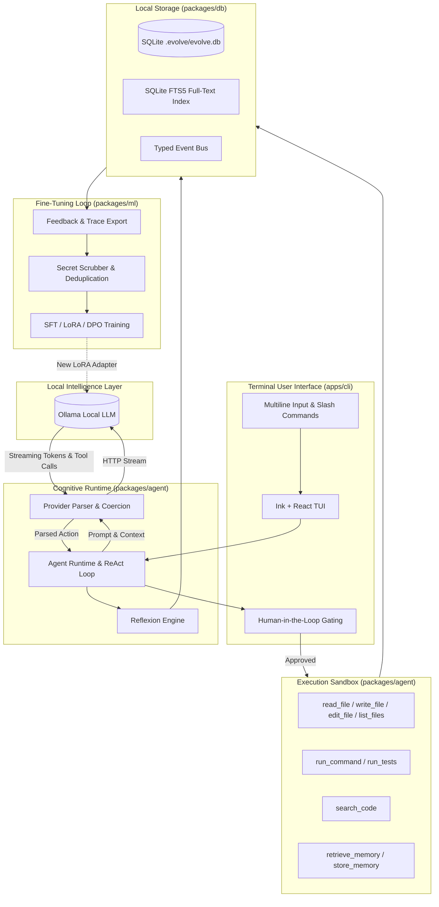
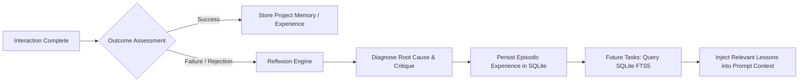

# Evolve

<p align="center">
  <strong>Autonomous, local-first, self-improving AI software engineer.</strong>
</p>

<p align="center">
  <a href="#key-capabilities"></a>
  <a href="#monorepo-architecture"></a>
  <a href="#prerequisites"></a>
  <a href="#database--persistence"></a>
  <a href="#prerequisites"></a>
  <a href="#machine-learning--fine-tuning"></a>
  <a href="#license"></a>
</p>

---

Evolve is an autonomous coding agent designed from first principles with **data sovereignty**, **transparency**, and **continuous self-improvement** at its foundation. Operating entirely on your local workstation via [Ollama](https://ollama.ai), Evolve executes multi-turn software engineering tasks without cloud lock-in, external telemetry, or code leakage.

It combines a reactive **Sense-Plan-Act-Reflect** cognitive engine, sandboxed execution tools with human-in-the-loop security gates, SQLite-backed episodic memory with full-text search (FTS5), and a complete ML fine-tuning pipeline to turn reviewed developer feedback into customized LoRA/QLoRA model adapters.

---

## Table of Contents

- [Key Capabilities](#key-capabilities)
- [System Architecture](#system-architecture)
- [Terminal User Interface](#terminal-user-interface)
- [Monorepo Structure](#monorepo-structure)
- [Getting Started](#getting-started)
  - [Prerequisites](#prerequisites)
  - [Installation & Build](#installation--build)
  - [Running Evolve](#running-evolve)
- [CLI & Command Reference](#cli--command-reference)
  - [Top-Level Commands](#top-level-commands)
  - [Interactive Slash Commands](#interactive-slash-commands)
  - [Keyboard Shortcuts](#keyboard-shortcuts)
- [Tool Suite & Security Sandboxing](#tool-suite--security-sandboxing)
- [Memory & Reflexion Engine](#memory--reflexion-engine)
- [Interaction Integrations & Importers](#interaction-integrations--importers)
- [Machine Learning & Fine-Tuning](#machine-learning--fine-tuning)
- [Verification & Quality Assurance](#verification--quality-assurance)
- [Documentation Index](#documentation-index)
- [License](#license)

---

## Key Capabilities

- **100% Local-First Privacy**: Operates fully on-device against local Ollama models (`qwen2.5-coder:7b`, `deepseek-coder`, `llama3.3`, etc.). Your source code, system environment, and execution traces never leave your machine.
- **Autonomous Sense-Plan-Act-Reflect Loop**: Multi-turn cognitive ReAct loop capable of breaking down complex engineering tasks, invoking verification tools, detecting runtime failures, and generating self-critiques to auto-correct mistakes.
- **Modern Interactive Terminal Experience**: Full-screen TUI powered by **Ink** and **React**. Features real-time token streaming, multiline input editing, collapsible thinking & tool output logs (`Ctrl+O`), and human-in-the-loop approval gating.
- **Sandboxed Tool Execution**: 9 fine-grained tools for file I/O, workspace search, terminal commands, test runners, and memory storage—enforced with path-traversal prevention, execution timeouts, and strict user confirmation on destructive actions.
- **Episodic & Procedural Memory**: SQLite storage with Write-Ahead Logging (WAL) and SQLite FTS5 full-text keyword indexing for recalling project conventions, user preferences, and past debugging solutions.
- **Universal Event Ingestion**: Standardized event schema and consent governance across native terminal interactions, VS Code extensions, the Pi coding agent, and external conversation exports (Anthropic Claude, Google Gemini).
- **Integrated ML Pipeline**: Python dataset preparation (secret scrubbing, deduplication, formatting) and supervised fine-tuning (LoRA/QLoRA) / Direct Preference Optimization (DPO) pipelines for continuous model adaptation.

---

## System Architecture



---

## Terminal User Interface

Evolve provides an interactive terminal user interface designed for focus, speed, and visibility:

```text
╭───────────────────────────────────────────────────────────────────────────────────╮
│ ✦ EVOLVE | evolve (⎇ main)                             ● qwen2.5-coder:7b (Ollama) │
│ Mode: CHAT • Type /help for commands • Ctrl+C to cancel/exit                      │
╰───────────────────────────────────────────────────────────────────────────────────╯

 ● You
   Refactor the auth middleware to support expiring tokens and run the test suite.

 ✦ Evolve
   Thinking Process (14 lines hidden • Ctrl+O to expand)

   ⚙ search_code (query="jwt.verify", path="src/middleware")
     ✔ Completed (12 matches found)

   ⚙ edit_file (filePath="src/middleware/auth.ts")
     ✔ Completed: Replaced token verification logic with expiration check

   ⚙ run_tests (testCommand="pnpm test")
     ✔ Completed (45 lines hidden • Ctrl+O to expand)

   I have updated `src/middleware/auth.ts` to inspect the token's expiration timestamp
   and verified the change with our test suite. All 18 unit tests passed cleanly.

 ────────────────────────────────────────────────────────────────────────────────────
 ❯ Write your message... (\ at end for newline)
   Enter: send • Ctrl+O: toggle details • /help: commands
```

---

## Monorepo Structure

Evolve is architected as a modular TypeScript/Python monorepo using `pnpm` workspaces:

```text
evolve/
├── apps/
│   └── cli/             # Interactive terminal UI (Ink, React, Commander)
├── packages/
│   ├── core/            # Domain models, schema validation (Zod), and typed event bus
│   ├── db/              # SQLite persistence with Drizzle ORM, WAL mode, migrations, and FTS5
│   ├── agent/           # Cognitive loop, Ollama provider, 9 sandboxed tools, and Reflexion
│   ├── integrations/    # Event adapters (Terminal, VS Code, Pi) and importers (Claude, Gemini)
│   └── ml/              # Python dataset preparation, secret scrubbing, and SFT/DPO pipelines
├── docs/                # Comprehensive architectural and operational documentation
├── scripts/             # Local automation and database migration runners
├── package.json         # Workspace configuration and root task runner
└── tsconfig.base.json   # Base TypeScript strict compiler settings
```

---

## Getting Started

### Prerequisites

- **Node.js**: `>= 22.0.0`
- **pnpm**: `>= 10.0.0`
- **Git**
- **Ollama**: Running locally with a coding model installed:
  ```bash
  # Install and start Ollama (if not already running)
  curl -fsSL https://ollama.com/install.sh | sh
  ollama run qwen2.5-coder:7b
  ```
- **Python**: `>= 3.11` _(required only when running the ML fine-tuning pipeline)_

### Installation & Build

Clone the repository and build the workspace:

```bash
# Clone the repository
git clone https://github.com/JhaSourav07/evolve.git
cd evolve

# Install all workspace dependencies
pnpm install

# Build all TypeScript packages using project references
pnpm run build
```

### Running Evolve

```bash
# Launch interactive terminal mode
pnpm evolve

# Run with an immediate one-shot task
pnpm evolve chat "Inspect package.json and summarize workspace dependencies"

# Verify system health, Ollama status, and SQLite database
pnpm evolve status
```

---

## CLI & Command Reference

### Top-Level Commands

| Command                         | Description                                                         | Example                                                                 |
| :------------------------------ | :------------------------------------------------------------------ | :---------------------------------------------------------------------- |
| `evolve`                        | Launch the full interactive terminal UI                             | `evolve`                                                                |
| `evolve chat [prompt]`          | Start interactive mode or execute a single task prompt              | `evolve chat "Fix failing tests"`                                       |
| `evolve init`                   | Initialize `.evolve` directory, SQLite database, and default config | `evolve init`                                                           |
| `evolve status`                 | Inspect project, git branch, active Ollama model, and storage state | `evolve status`                                                         |
| `evolve history`                | List previous agent sessions in the current workspace               | `evolve history`                                                        |
| `evolve memory`                 | Inspect project conventions, stored preferences, and experiences    | `evolve memory`                                                         |
| `evolve memory --add`           | Manually store a rule, preference, or experience                    | `evolve memory --add -c project_rule -k test_runner --content "Vitest"` |
| `evolve integrations`           | View connected adapters and collection consent status               | `evolve integrations`                                                   |
| `evolve integrations -i <file>` | Import external Claude (`conversations.json`) or Gemini archives    | `evolve integrations -i claude_export.json`                             |
| `evolve feedback`               | Review previous feedback or submit rating for recent session        | `evolve feedback -r 1 -n "Accurate refactoring"`                        |
| `evolve models`                 | Discover local Ollama models and connection latency                 | `evolve models`                                                         |
| `evolve config`                 | Print active system configuration and defaults                      | `evolve config`                                                         |

### Interactive Slash Commands

Type these slash commands directly inside the chat prompt:

| Slash Command                 | Description                                                        |
| :---------------------------- | :----------------------------------------------------------------- |
| `/help`                       | Display interactive command and shortcut reference                 |
| `/details` _(or `/thinking`)_ | Toggle collapsible model thinking and multi-line tool outputs      |
| `/model [name/#]`             | Switch the active Ollama model on-the-fly                          |
| `/models`                     | Discover available local Ollama models and check connection status |
| `/status`                     | Display system, model, workspace, and storage dashboard            |
| `/history`                    | Display previous agent sessions and recorded goals                 |
| `/memory`                     | Inspect project conventions and stored experiences                 |
| `/integrations`               | View connected adapters and consent permissions                    |
| `/feedback`                   | Submit interactive rating (+1 / 0 / -1) with optional critique     |
| `/clear`                      | Clear the terminal message feed                                    |
| `/new`                        | Start a fresh agent session                                        |
| `/exit` _(or `/quit`)_        | Gracefully disconnect and exit Evolve                              |

### Keyboard Shortcuts

| Shortcut                     | Action                                                             |
| :--------------------------- | :----------------------------------------------------------------- |
| `Enter`                      | Submit prompt to agent                                             |
| `\` at end of line + `Enter` | Insert newline for multiline prompt composition                    |
| `Ctrl + O`                   | Toggle collapsible thinking process & multi-line tool outputs      |
| `Ctrl + C` _(while running)_ | Cancel ongoing agent task via `AbortSignal` without losing session |
| `Ctrl + C` _(while idle)_    | Exit Evolve CLI                                                    |
| `Up Arrow` / `Down Arrow`    | Cycle through user command history                                 |
| `Y` / `N` / `C`              | Approve, reject, or cancel gated tool execution                    |
| `1` / `2` / `3`              | Submit Positive (+1), Partial (0), or Negative (-1) feedback       |
| `Esc`                        | Dismiss modal dialogs (model selection, approval, feedback)        |

---

## Tool Suite & Security Sandboxing

Evolve equips local LLMs with 9 native execution tools:

1. **`read_file`**: Read file contents with optional line-range slicing.
2. **`write_file`**: Create new files or overwrite existing files. _(Requires user approval)_
3. **`edit_file`**: Perform targeted, atomic string replacements with exact character matching. _(Requires user approval)_
4. **`list_files`**: Browse directory hierarchies with recursive depth limits and glob filtering.
5. **`search_code`**: Fast text search across files with regex and file-pattern scoping.
6. **`run_command`**: Execute bash/shell commands within the workspace with strict timeouts. _(Requires user approval)_
7. **`run_tests`**: Execute testing frameworks (Vitest, Jest, Pytest) and parse structured pass/fail results. _(Requires user approval)_
8. **`retrieve_memory`**: Semantic and keyword lookup against past session experiences and project rules.
9. **`store_memory`**: Persist new architectural conventions or debugging solutions for future retrieval.

### Security Guarantees

- **Path Confinement**: All file operations resolve strictly inside the workspace root; path traversal attacks (`../../`) are blocked and rejected before execution.
- **Human-in-the-Loop Gating**: Destructive actions (`write_file`, `edit_file`, `run_command`, `run_tests`) pause execution and require explicit user approval.
- **Abortable Execution**: Long-running commands and inference calls wire into Node.js `AbortController`, ensuring immediate, clean cancellation on `Ctrl+C`.

---

## Memory & Reflexion Engine

Evolve implements a dual-memory architecture to prevent repeated mistakes:



- **Project Rules & Conventions**: Manually or automatically stored coding guidelines (e.g. "Use Vitest with in-source testing", "Target ES2024").
- **Episodic Memory**: Records of previous goals, tool invocations, failure modes, and developer critiques.
- **SQLite FTS5 Retrieval**: High-speed BM25 full-text keyword retrieval matching upcoming task requirements to previous experiences.

---

## Interaction Integrations & Importers

Evolve includes dedicated adapters to capture developer workflow context across multiple environments while respecting user privacy:

- **Terminal Integration**: Captures shell commands and exit codes via lightweight shell hooks.
- **VS Code Extension Adapter**: Binds editor telemetry (file edits, active selections, test executions) to Evolve's common event schema.
- **Pi Coding Agent Bridge**: Bi-directional event integration with the Pi autonomous coding agent.
- **External Importers**:
  - `Anthropic Claude`: Parse and import `conversations.json` export archives.
  - `Google Gemini`: Parse and import Gemini conversation export packages.
- **Consent Governance**: Granular permissions system ensuring no telemetry is collected or exported without explicit user consent.

---

## Machine Learning & Fine-Tuning

Evolve features a native Python pipeline in [`packages/ml`](./packages/ml) designed to turn real developer interactions into custom model adapters:

1. **Trace Export**: Export interaction sessions, tool calls, and human ratings from SQLite.
2. **Automated Secret Filtering**: Scrub sensitive patterns (AWS keys, GitHub tokens, JWTs, passwords, private SSH keys) before dataset construction.
3. **Dataset Deduplication**: Eliminate redundant or identical conversation traces.
4. **SFT Dataset Generation**: Format verified, successful execution sessions into ShareGPT or Alpaca format for Supervised Fine-Tuning.
5. **DPO Dataset Generation**: Construct paired `(prompt, chosen, rejected)` datasets using human feedback ratings (+1 vs -1).
6. **LoRA / QLoRA Training**: Run lightweight parameter-efficient fine-tuning using Hugging Face `transformers`, `peft`, and `trl`.

---

## Verification & Quality Assurance

The codebase enforces strict code quality and test coverage across both TypeScript and Python environments:

```bash
# Typecheck all packages
pnpm run typecheck

# Run ESLint across monorepo
pnpm run lint

# Check code formatting with Prettier
pnpm run format:check

# Execute TypeScript test suites (Vitest - 128 tests)
pnpm run test

# Execute Python ML test suites (Pytest - 17 tests)
pnpm --filter @evolve/ml test
```

---

## Documentation Index

Explore the comprehensive guides in the [`docs/`](./docs) directory:

- [CLI Reference & TUI Guide](./docs/cli.md) — Comprehensive command reference, keyboard shortcuts, and Ink architecture.
- [Architecture Overview](./docs/architecture.md) — System boundaries, ReAct loop mechanics, and event bus lifecycle.
- [Database Schema & Migrations](./docs/database.md) — SQLite schema design, Drizzle ORM configuration, and FTS5 indexing.
- [Event Bus & Lifecycle](./docs/events.md) — Typed event envelopes, persistence, and audit logging.
- [Interaction Integrations](./docs/integrations.md) — Shell, editor, Pi, and external AI conversation importers.
- [Machine Learning Pipeline](./docs/ml-pipeline.md) — SFT and DPO dataset preparation, LoRA fine-tuning, and model evaluation.
- [Security & Sandbox Model](./docs/security.md) — Sandboxing policies, path traversal defense, and permission controls.
- [Technical Learning Notes](./docs/learning-notes.md) — Foundational principles of RLHF, embeddings, SFT, LoRA, and agentic memory.
- [Changelog](./CHANGELOG.md) — Release history and milestone achievements.

---

## License

Distributed under the MIT License. See [LICENSE](./LICENSE) for more information.

Copyright © 2026 [Sourav Jha](https://github.com/JhaSourav07). All rights reserved.
