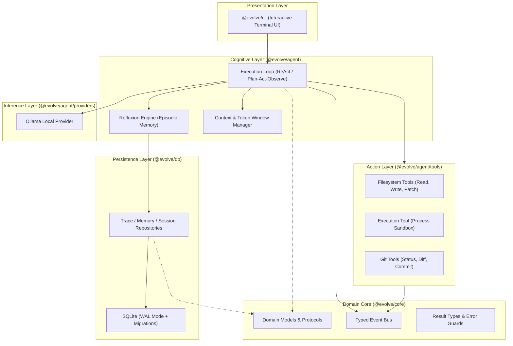
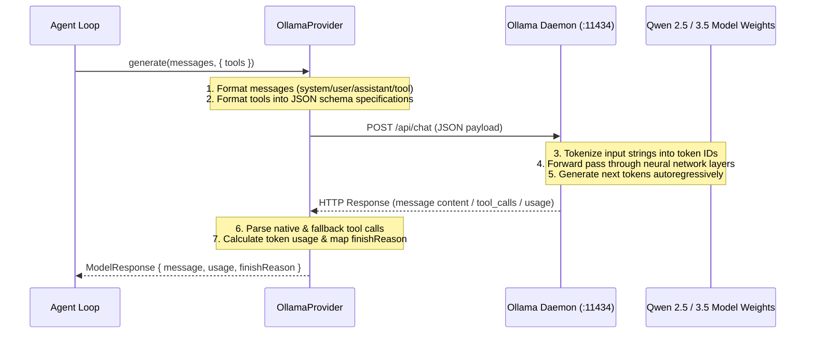
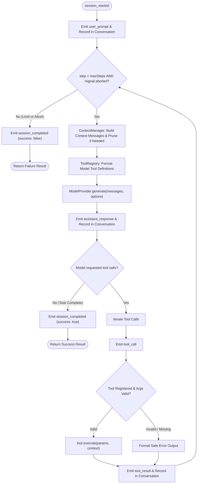

# Architecture Overview

## 1. System Vision

Evolve is an autonomous software engineering assistant that runs entirely on local infrastructure. It is designed around three non-negotiable guarantees:

1. **Local Execution**: Inference via local LLMs (Ollama), storage via SQLite.
2. **Auditability**: Every tool execution, reasoning step, and prompt token is logged as an immutable event trace.
3. **Continuous Reflection**: Errors and user interventions generate critique records stored in episodic memory to prevent repeated failure modes.

---

## 2. Layered Component Architecture

---

## 3. Package Responsibilities

| Package         | Location         | Responsibility                                                                                     | Dependencies                                 |
| :-------------- | :--------------- | :------------------------------------------------------------------------------------------------- | :------------------------------------------- |
| `@evolve/core`  | `packages/core`  | Pure domain types, events, error definitions, and result monads.                                   | Zero runtime dependencies                    |
| `@evolve/db`    | `packages/db`    | Database connection, schema migrations, query layer, and repository implementations.               | `@evolve/core`, `better-sqlite3` or `kysely` |
| `@evolve/agent` | `packages/agent` | ReAct cognitive loop, Ollama API client, tool definitions, execution sandbox, and reflexion logic. | `@evolve/core`, `@evolve/db`                 |
| `@evolve/cli`   | `apps/cli`       | Command-line parser, terminal UI, real-time event streaming, and approval prompts.                 | `@evolve/core`, `@evolve/agent`              |

---

## 4. Model Provider & Prompt Lifecycle

The `@evolve/agent` package connects the cognitive agent loop to local inference engines via `ModelProvider`:

---

## 5. The Cognitive Loop (Sense $\to$ Plan $\to$ Act $\to$ Observe $\to$ Reflect)

1. **Sense**: Gather workspace state, directory layout, recent git diffs, and the user's objective.
2. **Plan**: Formulate the next atomic action using the local model. If a plan requires multiple steps, output structured tool calls.
3. **Act**: Execute the requested tool inside an audited, safe execution boundary.
4. **Observe**: Read the tool output (stdout, stderr, exit code, file contents).
5. **Reflect**: If the action fails (test failure, syntax error, missing dependency), evaluate the cause, create an episodic reflection, and adjust the next planning step.

---

## 6. Agent Runtime Architecture (`AgentRuntime`)

The agent runtime in `@evolve/agent` manages the autonomous execution loop independently of specific CLI interfaces or model providers:

### 6.1 Key Components

1. **`AgentRuntime`**:
   - The central orchestrator that drives iterations from start to conclusion.
   - Manages cancellation via standard `AbortSignal`.
   - Protects against runaway execution loops via configurable `maxSteps` (default: 20).
   - Encapsulates error recovery: crashes in tools or invalid tool parameters are converted into informative tool responses rather than crashing the runtime.
   - Emits strongly-typed, schema-validated lifecycle events at every step (`session_started`, `user_prompt`, `assistant_response`, `tool_call`, `tool_result`, `session_completed`).

2. **`ConversationManager`**:
   - Maintains the canonical sequence of messages: system messages, user queries, assistant replies, and tool results.
   - Preserves message order and provides serializable state snapshots (`toJSON` / `fromJSON`).

3. **`ContextManager`**:
   - Computes fast token estimates (~4 characters/token rule of thumb).
   - Assembles system instructions including workspace constraints, environment data, and operational guidelines.
   - Enforces token budgets (`maxContextTokens`): prunes middle conversation history while strictly preserving the system prompt, the initial user goal, and atomic tool-call/tool-result pairings.

4. **`ToolRegistry`**:
   - Central catalog for registering executable `AgentTool` implementations.
   - Automatically converts Zod parameter schemas into JSON Schema specifications consumed by LLMs.
