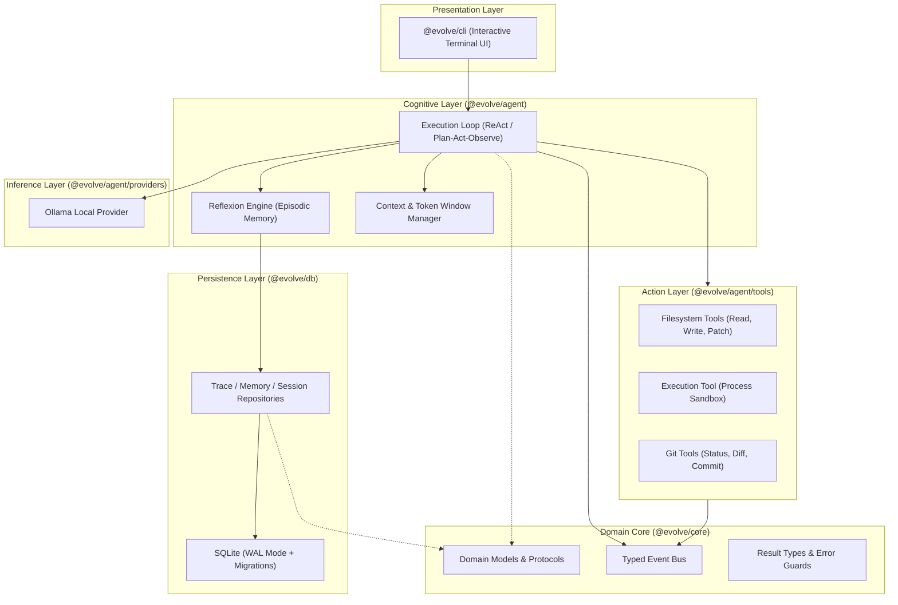

# Architecture Overview

## 1. System Vision

Evolve is an autonomous software engineering assistant that runs entirely on local infrastructure. It is designed around three non-negotiable guarantees:

1. **Local Execution**: Inference via local LLMs (Ollama), storage via SQLite.
2. **Auditability**: Every tool execution, reasoning step, and prompt token is logged as an immutable event trace.
3. **Continuous Reflection**: Errors and user interventions generate critique records stored in episodic memory to prevent repeated failure modes.

---

## 2. Layered Component Architecture

---

## 3. Package Responsibilities

| Package         | Location         | Responsibility                                                                                     | Dependencies                                 |
| :-------------- | :--------------- | :------------------------------------------------------------------------------------------------- | :------------------------------------------- |
| `@evolve/core`  | `packages/core`  | Pure domain types, events, error definitions, and result monads.                                   | Zero runtime dependencies                    |
| `@evolve/db`    | `packages/db`    | Database connection, schema migrations, query layer, and repository implementations.               | `@evolve/core`, `better-sqlite3` or `kysely` |
| `@evolve/agent` | `packages/agent` | ReAct cognitive loop, Ollama API client, tool definitions, execution sandbox, and reflexion logic. | `@evolve/core`, `@evolve/db`                 |
| `@evolve/cli`   | `apps/cli`       | Command-line parser, terminal UI, real-time event streaming, and approval prompts.                 | `@evolve/core`, `@evolve/agent`              |

---

## 4. The Cognitive Loop (Sense $\to$ Plan $\to$ Act $\to$ Observe $\to$ Reflect)

1. **Sense**: Gather workspace state, directory layout, recent git diffs, and the user's objective.
2. **Plan**: Formulate the next atomic action using the local model. If a plan requires multiple steps, output structured tool calls.
3. **Act**: Execute the requested tool inside an audited, safe execution boundary.
4. **Observe**: Read the tool output (stdout, stderr, exit code, file contents).
5. **Reflect**: If the action fails (test failure, syntax error, missing dependency), evaluate the cause, create an episodic reflection, and adjust the next planning step.
