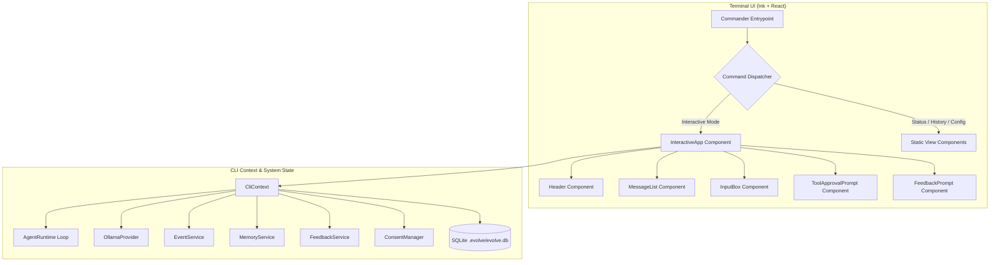

# Evolve CLI & Terminal User Interface

## 1. Overview & Architecture

Evolve features a professional, minimalist terminal user interface (TUI) inspired by modern developer-first AI tools like Claude Code and the Pi coding agent. Built with **Ink** and **React**, Evolve brings component-based rendering, reactive state management, and real-time streaming to the terminal without excessive decorative borders or slow, cluttered visual styling.



---

## 2. Command Reference

All commands can be invoked using `evolve` (or `node apps/cli/dist/index.js` during local development):

| Command                         | Description                                                         | Example                                                               |
| ------------------------------- | ------------------------------------------------------------------- | --------------------------------------------------------------------- |
| `evolve`                        | Launch interactive chat mode with full TUI                          | `evolve`                                                              |
| `evolve chat [prompt]`          | Start interactive mode or execute a single task prompt              | `evolve chat "Refactor auth.ts to use argon2"`                        |
| `evolve init`                   | Initialize `.evolve` directory, SQLite database, and default config | `evolve init`                                                         |
| `evolve status`                 | Display dashboard with project, git, model, and storage state       | `evolve status`                                                       |
| `evolve history`                | List previous agent sessions in the current project                 | `evolve history`                                                      |
| `evolve memory`                 | Inspect project conventions, rules, and stored experiences          | `evolve memory`                                                       |
| `evolve memory --add`           | Store a new preference, project rule, or experience                 | `evolve memory --add -c project_rule -k test_tool --content "Vitest"` |
| `evolve integrations`           | View connected integrations and consent governance status           | `evolve integrations`                                                 |
| `evolve integrations -i <file>` | Import external Claude (`conversations.json`) or Gemini archive     | `evolve integrations -i claude_export.json`                           |
| `evolve feedback`               | Review previous feedback history or submit rating                   | `evolve feedback -r 1 -n "Accurate refactor"`                         |
| `evolve config`                 | Print active configuration parameters                               | `evolve config`                                                       |
| `evolve models`                 | Discover local Ollama models and check connection status            | `evolve models`                                                       |

---

## 3. Interactive Chat Interface

When launching `evolve` or `evolve chat`, the interactive full-screen interface activates:

### 3.1 Slash Commands

Within the chat input box, type slash commands for quick navigation:

- `/help`: Display available commands and shortcuts.
- `/status`: Show system, model, workspace, and storage dashboard.
- `/history`: Inspect previous sessions and goals.
- `/memory`: Review project conventions and stored experiences.
- `/integrations`: Check consent governance and connected adapters.
- `/models`: Discover available local Ollama models.
- `/model [name/#]`: Switch or select the active Ollama model.
- `/details` (or `/thinking`): Toggle collapsible model thinking and multi-line tool outputs (Shortcut: `Ctrl + O`).
- `/feedback`: Rate the last agent interaction (+1 / 0 / -1).
- `/clear`: Clear the on-screen message list.
- `/new`: Start a fresh agent session.
- `/exit` or `/quit`: Cleanly disconnect and exit Evolve.

### 3.2 Tool Execution & Approval

When Evolve requests tools, execution details are rendered with clear indicators:

- Reading a file (`read_file`): Displays file path and read byte count.
- Editing a file (`edit_file`): Displays target file and applied replacements.
- Running commands (`run_command`): Displays command string, working directory, and execution duration.
- Testing (`run_tests`): Displays detected test runner and pass/fail summary.

#### Human-in-the-Loop Gating

When a destructive tool is triggered (`write_file`, `edit_file`, `run_command`, `run_tests`), Evolve displays an interactive prompt:

```
⛨ Action Requires Approval: run_command
  command: "pnpm test"
  cwd: "/workspace/evolve"

Press [Y] Approve • [N] Reject • [C] Cancel
```

Approval checks are strictly enforced by the backend `ToolApprovalHandler` and can never be bypassed.

### 3.3 Cancellation

Press **Ctrl + C** at any point while Evolve is thinking or executing tools. The runtime receives an `AbortSignal`, halts model generation and child processes, emits a cancellation notice, and returns to the input prompt without crashing or corrupting state.

---

## 4. Keyboard Shortcuts Reference

| Shortcut                     | Action                                                       |
| ---------------------------- | ------------------------------------------------------------ |
| `Enter`                      | Submit prompt to agent                                       |
| `\` at end of line + `Enter` | Insert newline for multiline input                           |
| `Up Arrow`                   | Navigate backwards through command history                   |
| `Down Arrow`                 | Navigate forwards through command history                    |
| `Ctrl + O`                   | Toggle collapsible thinking & multi-line tool output details |
| `Ctrl + C` (while running)   | Cancel ongoing agent task                                    |
| `Ctrl + C` (while idle)      | Exit Evolve CLI                                              |
| `Y` / `N` / `C`              | Approve, reject, or cancel gated tool execution              |
| `1` / `2` / `3`              | Submit Correct (+1), Partial (0), or Incorrect (-1) feedback |
| `Esc`                        | Dismiss modal prompts (approval or feedback)                 |

---

## 5. Educational Notes: TUI Engineering with Ink

### 5.1 How Ink Works

**Ink** is an implementation of React that targets command-line interfaces.

- Standard React reconciles virtual DOM nodes into browser DOM elements (`<div>`, `<span>`).
- Ink reconciles React components into a terminal render tree. It embeds the **Yoga layout engine** (Facebook's C++ flexbox implementation compiled to WebAssembly), enabling full Flexbox layouts (`flexDirection="column"`, `justifyContent="space-between"`, `padding={1}`) directly inside terminal windows.
- Ink converts the layout tree into ANSI escape code strings (cursor positioning, text colors, background colors) and writes them to `process.stdout`.

### 5.2 How Terminal Rendering Works

Terminals render text sequentially into character grids. To create interactive interfaces:

1. **ANSI Escape Sequences**: Special byte sequences starting with `\x1b[` (ESC `[`) instruct the terminal emulator to alter styles (e.g., `\x1b[32m` for green), move the cursor (`\x1b[10;5H` to jump to row 10, col 5), or clear lines (`\x1b[2K`).
2. **Diffing & Repainting**: Rather than redrawing the whole screen on every change (which causes screen flickering), Ink calculates the minimum diff of changed characters, repositions the cursor, and updates only the altered terminal rows.

### 5.3 React State in CLI Applications

In the browser, React re-renders on state changes and relies on browser layout passes. In the terminal:

- Hook state changes (`useState`, `useEffect`) trigger Ink's reconciler.
- `useInput((input, key) => ...)` taps directly into `process.stdin` raw mode, decoding keystrokes and control characters (`key.ctrl`, `key.return`, `key.escape`).
- When state updates, Ink computes a new Flexbox layout with Yoga and rewrites stdout.

### 5.4 Streaming Responses & Agent Runtime Communication

- Streaming tokens from Ollama arrive via `AsyncIterable<ModelStreamChunk>`.
- In `InteractiveApp`, each chunk or tool event is appended to component state (`setMessages((prev) => [...prev, newChunk])`).
- The reactive loop immediately repaints the bottom of the message feed, giving developers real-time token generation feedback.
- The UI stays decoupled from backend execution: `AgentRuntime` communicates purely through `AbortSignal`, callbacks (`ToolApprovalHandler`), and strongly-typed events (`EventEnvelope`).
