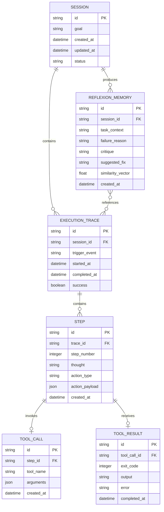

# Database Architecture & Storage

## 1. Storage Strategy

Evolve uses **SQLite** for local persistence.

### Why SQLite?
- **Zero Server Setup**: Single file database embedded in the application process.
- **ACID Compliant**: Complete transaction guarantees and crash safety.
- **WAL Mode (Write-Ahead Logging)**: High-concurrency reads alongside concurrent writes without locking reader transactions.
- **Portability**: Database files live in `.evolve/evolve.db` inside user workspaces or user home directories, easily inspected with standard CLI tools (`sqlite3`).

---

## 2. Planned Schema Entities

---

## 3. Migration Strategy
All database migrations are version-controlled SQL files running sequentially with automated rollback capability.
