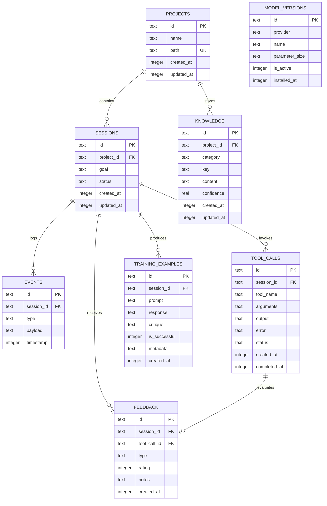

# Database Architecture & Storage

## 1. Storage Strategy

Evolve uses **SQLite** with **Drizzle ORM** for local-first persistence.

### Why SQLite + Drizzle ORM?

- **Embedded & Zero Configuration**: SQLite runs directly inside the Node.js process using native C bindings (`better-sqlite3`). No database server, ports, or credentials required.
- **WAL Mode (Write-Ahead Logging)**: High-concurrency reads alongside concurrent writes without locking reader transactions (`PRAGMA journal_mode = WAL;`).
- **Foreign Key Enforcement**: Explicitly enabled on every connection (`PRAGMA foreign_keys = ON;`) to guarantee relational integrity and prevent orphan records.
- **Drizzle ORM Type Safety**: Drizzle provides compile-time TypeScript type inference from table schemas with zero runtime overhead and direct SQL compatibility.
- **Portability**: All project data lives in `.evolve/evolve.db`, making backups, inspection, and state transfer trivial.

---

## 2. Entity Relationship Diagram



---

## 3. Database Tables Breakdown

| Table               | Purpose                                                                      | Primary Key | Foreign Keys                                                                      | Key Indexes                          |
| :------------------ | :--------------------------------------------------------------------------- | :---------- | :-------------------------------------------------------------------------------- | :----------------------------------- |
| `projects`          | Tracks workspace project paths and metadata.                                 | `id`        | None                                                                              | `path` (UNIQUE)                      |
| `sessions`          | Represents user interactions or task goals.                                  | `id`        | `project_id -> projects(id)` ON DELETE CASCADE                                    | `project_id`, `status`               |
| `events`            | Append-only event stream of the entire execution.                            | `id`        | `session_id -> sessions(id)` ON DELETE CASCADE                                    | `session_id`, `type`, `timestamp`    |
| `tool_calls`        | Records tool execution requests, arguments, outputs, and errors.             | `id`        | `session_id -> sessions(id)` ON DELETE CASCADE                                    | `session_id`, `status`, `tool_name`  |
| `feedback`          | Captures human and automated evaluations for actions and sessions.           | `id`        | `session_id -> sessions(id)`, `tool_call_id -> tool_calls(id)` ON DELETE SET NULL | `session_id`, `tool_call_id`, `type` |
| `knowledge`         | Self-improving episodic memory and project rules (Reflexion).                | `id`        | `project_id -> projects(id)` ON DELETE CASCADE                                    | `project_id`, `category`, `key`      |
| `training_examples` | Curated prompt/response pairs with critiques for evaluation and fine-tuning. | `id`        | `session_id -> sessions(id)` ON DELETE SET NULL                                   | `session_id`, `is_successful`        |
| `model_versions`    | Tracks local models available via Ollama or custom providers.                | `id`        | None                                                                              | `provider`, `name`                   |

---

## 4. Migration Engine

Migrations are tracked in the `schema_migrations` table:

```sql
CREATE TABLE IF NOT EXISTS schema_migrations (
  id TEXT PRIMARY KEY,
  applied_at INTEGER NOT NULL
);
```

The migration runner ([packages/db/src/migrations/runner.ts](file:///run/media/sourav/New%20Volume/Projects/evolve/packages/db/src/migrations/runner.ts)) executes pending migrations sequentially inside an atomic transaction when the application initializes.

---

## 5. Repository Pattern

Application code and the CLI never write raw SQL. All operations are encapsulated in typed repositories:

- `ProjectRepository`
- `SessionRepository`
- `EventRepository`
- `ToolCallRepository`
- `FeedbackRepository`
- `KnowledgeRepository`
- `TrainingRepository`
- `ModelVersionRepository`

Multi-step operations (e.g. creating a session with an initial event, or completing a tool call with feedback) use atomic `db.transaction()` blocks to prevent inconsistent database states.
