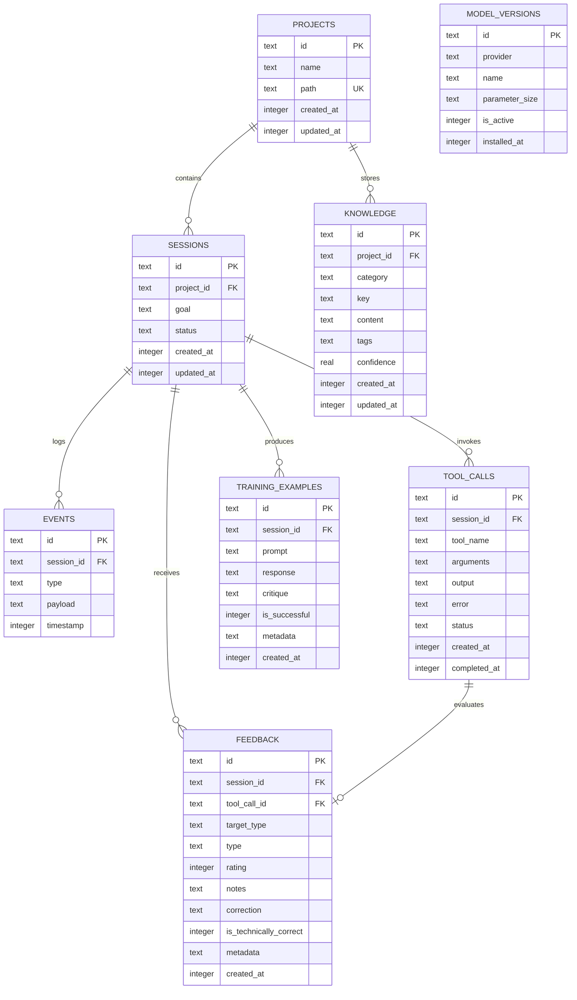

# Database Architecture & Storage

## 1. Storage Strategy

Evolve uses **SQLite** with **Drizzle ORM** for local-first persistence.

### Why SQLite + Drizzle ORM?

- **Embedded & Zero Configuration**: SQLite runs directly inside the Node.js process using native C bindings (`better-sqlite3`). No database server, ports, or credentials required.
- **WAL Mode (Write-Ahead Logging)**: High-concurrency reads alongside concurrent writes without locking reader transactions (`PRAGMA journal_mode = WAL;`).
- **Foreign Key Enforcement**: Explicitly enabled on every connection (`PRAGMA foreign_keys = ON;`) to guarantee relational integrity and prevent orphan records.
- **Drizzle ORM Type Safety**: Drizzle provides compile-time TypeScript type inference from table schemas with zero runtime overhead and direct SQL compatibility.
- **Full-Text Search (FTS5)**: Embedded tokenized keyword search with BM25 ranking for sub-millisecond memory retrieval without external vector services.
- **Portability**: All project data lives in `.evolve/evolve.db`, making backups, inspection, and state transfer trivial.

---

## 2. Entity Relationship Diagram



---

## 3. Database Tables Breakdown

| Table               | Purpose                                                                               | Primary Key | Foreign Keys                                                                      | Key Indexes                                         |
| :------------------ | :------------------------------------------------------------------------------------ | :---------- | :-------------------------------------------------------------------------------- | :-------------------------------------------------- |
| `projects`          | Tracks workspace project paths and metadata.                                          | `id`        | None                                                                              | `path` (UNIQUE)                                     |
| `sessions`          | Represents user interactions or task goals.                                           | `id`        | `project_id -> projects(id)` ON DELETE CASCADE                                    | `project_id`, `status`                              |
| `events`            | Append-only event stream of the entire execution.                                     | `id`        | `session_id -> sessions(id)` ON DELETE CASCADE                                    | `session_id`, `type`, `timestamp`                   |
| `tool_calls`        | Records tool execution requests, arguments, outputs, and errors.                      | `id`        | `session_id -> sessions(id)` ON DELETE CASCADE                                    | `session_id`, `status`, `tool_name`                 |
| `feedback`          | Captures action- and response-level evaluations, corrections, and technical verdicts. | `id`        | `session_id -> sessions(id)`, `tool_call_id -> tool_calls(id)` ON DELETE SET NULL | `session_id`, `tool_call_id`, `type`, `target_type` |
| `knowledge`         | Self-improving memory: user preferences, project conventions, and past experiences.   | `id`        | `project_id -> projects(id)` ON DELETE CASCADE                                    | `project_id`, `category`, `key`                     |
| `training_examples` | Curated prompt/response pairs with critiques for evaluation and fine-tuning.          | `id`        | `session_id -> sessions(id)` ON DELETE SET NULL                                   | `session_id`, `is_successful`                       |
| `model_versions`    | Tracks local models available via Ollama or custom providers.                         | `id`        | None                                                                              | `provider`, `name`                                  |

---

## 4. Full-Text Search Virtual Table (`memory_fts`)

Evolve uses SQLite's built-in **FTS5** extension for fast BM25 keyword matching over all saved knowledge, preferences, and experiences:

```sql
CREATE VIRTUAL TABLE IF NOT EXISTS memory_fts USING fts5(
  id UNINDEXED,
  project_id UNINDEXED,
  category,
  key,
  content,
  tags,
  tokenize = 'porter unicode61'
);
```

### Search Query & Relevance Scoring

Queries are sanitized into prefix boolean expressions (e.g. `"tsc"* OR "noEmit"*`) and ranked by BM25:

```sql
SELECT id, project_id, category, key, content, tags, bm25(memory_fts) as rank
FROM memory_fts
WHERE memory_fts MATCH ?
ORDER BY rank
LIMIT ?;
```

---

## 5. Feedback & Training Example Generation

### Action-Level vs. Response-Level Feedback

- **Action-Level Feedback (`target_type: 'action'`)**: Evaluates a specific atomic action taken by the agent (`tool_call_id`).
- **Response-Level Feedback (`target_type: 'response'`)**: Evaluates the overall outcome of a session (`session_id`).

### The Technical Correctness Rule

> **Crucial Invariant**: A positive human rating (+1) does **not** automatically imply that the solution is technically correct.

When transforming feedback into a fine-tuning training example via `FeedbackService.convertToTrainingExample()`:

```typescript
const isPositive = feedback.rating !== null && feedback.rating > 0;
const isTechnicallyVerified = feedback.isTechnicallyCorrect === true;
const isSuccessful = isPositive && isTechnicallyVerified ? 1 : 0;
```

If a human likes the explanation but unit tests failed or were unverified, `isSuccessful` remains `0`.
If a human provides a written correction (`feedback.correction`), that correction replaces the original assistant response as the gold-standard target in `training_examples`.

---

## 6. Migration Engine

Migrations are tracked in the `schema_migrations` table:

```sql
CREATE TABLE IF NOT EXISTS schema_migrations (
  id TEXT PRIMARY KEY,
  applied_at INTEGER NOT NULL
);
```

The migration runner sequentially applies versioned migration scripts:

1. `001_initial_schema`: Initial 8 tables, indexes, and foreign keys.
2. `002_feedback_and_memory`: Adds `target_type`, `correction`, `is_technically_correct`, and `metadata` to `feedback`, adds `tags` to `knowledge`, and provisions the `memory_fts` FTS5 virtual table.
