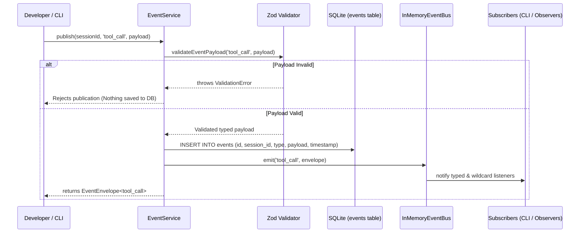

# Event System & Lifecycle

## 1. Conceptual Foundations

### What is Event-Driven Architecture?

In an **Event-Driven Architecture (EDA)**, the flow of the program is determined by the production, detection, and consumption of **events**.

- Components do not call each other directly; they emit notifications when state changes occur.
- **Loose Coupling**: The agent runtime doesn't need to know whether the CLI, a database logger, an analytics dashboard, or a testing harness is listening.

### What is an Event Emitter?

An **Event Emitter** is an object that maintains a registry of listeners and dispatches messages to them synchronously or asynchronously when named events occur. Evolve's `InMemoryEventBus` provides typed event dispatching with subscriber fault isolation.

### What is Event Sourcing?

Instead of only storing the _current state_ of an entity (e.g. `session.status = 'completed'`), **Event Sourcing** records the full, immutable sequence of events that led to that state:
$$\text{State} = \sum_{i=1}^{N} \text{Event}_i$$
In Evolve, any past agent run can be reconstructed and replayed step-by-step from its event log.

### What is the Difference Between an Event and a Database Record?

- A **database record** represents the _current snapshot_ of mutable state (e.g. `status = "completed"`). Updating it overwrites the past.
- An **event** is an _immutable statement of historical fact_ with a timestamp (e.g. `command_execution` followed by `execution_result`). Events can only be appended, never edited or deleted.

### Why Must Raw Interactions Be Preserved?

1. **Self-Improvement (Reflexion)**: To learn from mistakes, the agent must inspect exactly what prompt it received, what tool it called, and the raw compiler error that followed.
2. **Deterministic Debugging**: When an agent goes off the rails, you can inspect the exact token sequence that led to the hallucination.
3. **Auditability & Safety**: Complete transparency on what files were modified and what shell commands were executed.

---

## 2. Supported Core Events

Evolve implements strict Zod validation for 11 core event types:

| Event Type           | Purpose                                      | Payload Fields                                                       |
| :------------------- | :------------------------------------------- | :------------------------------------------------------------------- |
| `session_started`    | Initialization of a goal or task.            | `goal`, `workspaceRoot`, `modelConfig?`                              |
| `user_prompt`        | Human input or instruction.                  | `prompt`, `context?`                                                 |
| `assistant_response` | Model reasoning or conversation text.        | `content`, `model?`, `finishReason?`                                 |
| `tool_call`          | Model requesting a discrete tool invocation. | `toolCallId`, `toolName`, `arguments`                                |
| `tool_result`        | Output or error produced by a tool.          | `toolCallId`, `toolName`, `output?`, `error?`, `success`             |
| `command_execution`  | Subprocess shell execution initiated.        | `commandId`, `command`, `cwd`, `timeoutMs?`                          |
| `execution_result`   | Shell command exit code, stdout, and stderr. | `commandId`, `command`, `exitCode`, `stdout`, `stderr`, `durationMs` |
| `human_feedback`     | Rating and critique from the user.           | `feedbackId`, `feedbackType`, `rating?`, `notes?`, `toolCallId?`     |
| `solution_accepted`  | User accepts proposed solution.              | `summary`, `acceptedAt`, `filesChanged?`                             |
| `solution_rejected`  | User rejects proposed solution.              | `reason`, `rejectedAt`, `feedback?`                                  |
| `session_completed`  | End of agent task lifecycle.                 | `success`, `durationMs`, `summary?`, `error?`                        |

---

## 3. The Complete Event Lifecycle



---

## 4. Usage Example: `EventService`

```typescript
import { initDatabase, EventService } from '@evolve/db';

const { db } = initDatabase();
const eventService = new EventService(db);

// 1. Subscribe to specific event
const unsubscribe = eventService.subscribeTo('tool_call', (envelope) => {
  console.log(`Tool called: ${envelope.payload.toolName}`);
});

// 2. Publish validated event (persists to SQLite & notifies subscribers)
const event = eventService.publish('sess_123', 'tool_call', {
  toolCallId: 'call_1',
  toolName: 'fs_read',
  arguments: { path: 'package.json' },
});

// 3. Retrieve ordered session event history
const history = eventService.getSessionEvents('sess_123');

// 4. Filter events
const commandEvents = eventService.filter({
  sessionId: 'sess_123',
  types: ['command_execution', 'execution_result'],
});
```
