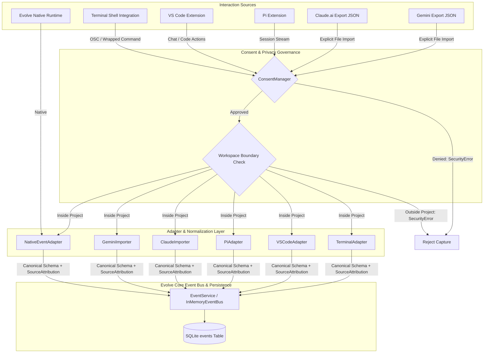

# Evolve Interaction Integrations

## 1. Overview & Architecture

Evolve is designed to observe developer-agent interactions across multiple development surfaces—the terminal, code editors, peer agent extensions, and exported conversation archives—without sacrificing privacy or security.

Every integration transforms heterogeneous external interaction formats into Evolve's canonical **11 core event types**, validating payloads against strict Zod schemas, enforcing explicit user consent, verifying project workspace boundaries, and attaching immutable source attribution metadata.



---

## 2. Core Concepts & Educational Fundamentals

### 2.1 How VS Code Extensions Work

VS Code executes extensions within a dedicated, isolated process called the **Extension Host**. This isolation ensures that long-running operations in an extension never freeze the editor's UI thread.

- **Manifest (`package.json`)**: Declares `activationEvents` (e.g., `onCommand:evolve.chat`, `onLanguage:typescript`) and `contributes` (commands, configuration settings, custom views, status bar items).
- **Lifecycle**: The Extension Host calls `activate(context: vscode.ExtensionContext)` when triggered and `deactivate()` on shutdown.
- **APIs**:
  - `vscode.chat.createChatParticipant`: Registers chat participants to handle prompt requests and stream response chunks.
  - `vscode.languages.registerCodeActionsProvider`: Supplies Quick Fix and Refactoring actions.
  - `vscode.workspace.onDidChangeTextDocument`: Listens to document edits within open workspaces.
- In Evolve, `VSCodeAdapter` maps chat prompts, responses, code actions, diff accept/reject decisions, and thumbs-up/down ratings into standard Evolve events.

### 2.2 How Shell Integration Works

Modern terminal emulators (VS Code integrated terminal, iTerm2, WezTerm) integrate with underlying shells using **Operating System Command (OSC)** sequences or shell lifecycle hooks:

- **OSC 133 / OSC 633 Sequences**:
  - `133;A`: Prompt started (marks the line where the user types).
  - `133;B`: Command started (user hit Enter).
  - `133;C`: Command execution started (output streaming begins).
  - `133;D;{exitCode}`: Command finished with status code.
- **Shell Startup Hooks**: In Bash (`PROMPT_COMMAND`), Zsh (`preexec`, `precmd`), or Fish (`fish_preexec`), the shell emits structured markers around user commands.
- In Evolve, `TerminalAdapter` captures explicitly wrapped or observed commands, extracting the exact command line, duration, working directory, exit code, and stdout/stderr. Commands run outside the authorized workspace root are strictly rejected.

### 2.3 How Event Adapters Work

The **Adapter Pattern** decouples heterogeneous external event formats from Evolve's internal event domain:

1. Accepts raw payloads from a third-party source.
2. Evaluates security and consent policies via `ConsentManager`.
3. Validates that the active directory or target file is inside the approved workspace.
4. Normalizes external structures into Evolve's 11 core event types.
5. Generates immutable `SourceAttribution` metadata.
6. Emits `IntegratedEventEnvelope<T>` to `EventService`.

### 2.4 How External Conversation Imports Work

Developers frequently build workflows in Claude.ai or Google Gemini before transferring code to autonomous agents.
An importer operates in 4 stages:

1. **Consent Verification**: Requires explicit user authorization to process imported files (`allowClaudeImport`, `allowGeminiImport`).
2. **Schema Validation**: Validates the JSON structure against expected platform schemas using Zod.
3. **Session Reconstruction**: Maps platform conversation objects to Evolve sessions, creating a unique `SessionId`.
4. **Chronological Normalization**: Sorts messages by timestamp and emits `session_started`, `user_prompt`, `assistant_response`, `tool_call`, `tool_result`, and `session_completed`.

### 2.5 How to Normalize Different Data Formats

Different AI platforms use conflicting structures for identical concepts:

| Platform      | User Turn         | Assistant Turn        | Tool Invocation                             | Tool Result                                         |
| ------------- | ----------------- | --------------------- | ------------------------------------------- | --------------------------------------------------- |
| **Evolve**    | `user_prompt`     | `assistant_response`  | `tool_call`                                 | `tool_result`                                       |
| **Claude.ai** | `sender: "human"` | `sender: "assistant"` | `tool_use: { id, name, input }`             | `tool_result: { id, content, is_error }`            |
| **Gemini**    | `role: "user"`    | `role: "model"`       | `parts: [{ functionCall: { name, args } }]` | `parts: [{ functionResponse: { name, response } }]` |

Normalizers map disparate role names and nested part structures into Evolve's flat, strongly-typed event schemas.

---

## 3. Privacy & Consent Governance

> [!IMPORTANT]
> **Strict Anti-Scraping Guarantee**:
> Evolve never scrapes private application state, browser cookies, OS keylogs, or unrelated background terminal activity. All interaction collection requires explicit opt-in consent and is strictly confined to authorized project workspace directories.

### 3.1 Consent Policies

`ConsentManager` gates all interaction ingestion. By default, only native agent execution (`evolve_native`) is permitted:

```typescript
const consent = new ConsentManager({
  allowTerminalCollection: true,
  allowVSCodeCollection: true,
  allowClaudeImport: true,
  allowGeminiImport: true,
  allowedWorkspaceRoots: ['/path/to/project'],
});
```

If an integration attempts to publish events without consent, a `SecurityError` is thrown immediately.

### 3.2 Source Attribution

Every integrated event envelope includes an immutable `SourceAttribution` block:

```typescript
export interface SourceAttribution {
  source: 'evolve_native' | 'terminal' | 'vscode' | 'pi' | 'claude_import' | 'gemini_import';
  originalId?: string;
  importedAt: number;
  consentGranted: boolean;
  consentScope: 'workspace_only' | 'session_only' | 'explicit_command' | 'explicit_file_import';
  metadata?: Record<string, unknown>;
}
```

---

## 4. Supported Integrations

### 1. Evolve Native Events (`NativeEventAdapter`)

Provides direct event recording for internal agent loops, CLI commands, and local tool calls:

- `recordUserPrompt(sessionId, prompt, context)`
- `recordAssistantResponse(sessionId, content, model)`
- `recordToolCall(sessionId, toolCallId, toolName, args)`
- `recordToolResult(sessionId, toolCallId, toolName, success, output, error)`
- `recordCommandExecution(sessionId, commandId, command, cwd, timeoutMs)`
- `recordExecutionResult(sessionId, commandId, command, exitCode, stdout, stderr, durationMs)`
- `recordHumanFeedback(sessionId, feedbackId, rating, feedbackType, notes)`
- `recordSolutionAccepted(sessionId, summary, acceptedAt, filesChanged)`
- `recordSolutionRejected(sessionId, reason, rejectedAt, feedback)`
- `recordSessionStarted(sessionId, goal, workspaceRoot)`
- `recordSessionCompleted(sessionId, success, durationMs, summary)`

### 2. Terminal Integration (`TerminalAdapter`)

Captures developer commands and outputs executed inside approved workspaces:

- `startSession(input)`: Emits `session_started`.
- `capturePrompt(input)`: Emits `user_prompt`.
- `captureCommand(input)`: Emits `command_execution`.
- `captureResult(input)`: Emits `execution_result`.
- `endSession(input)`: Emits `session_completed`.

### 3. VS Code Extension Integration (`VSCodeAdapter`)

Translates IDE user actions and chat turns into Evolve events:

- `handleChatPrompt(input)`: Emits `user_prompt` with active file and editor selection context.
- `handleAssistantResponse(input)`: Emits `assistant_response`.
- `handleCodeAction(input)`: Emits `tool_call` for applied Quick Fixes or refactorings.
- `handleCodeActionResult(input)`: Emits `tool_result`.
- `handleSolutionFeedback(input)`: Emits `solution_accepted` or `solution_rejected`.
- `handleChatFeedback(input)`: Emits `human_feedback` for thumbs-up (+1) or thumbs-down (-1).

### 4. Pi Extension Integration (`PiAdapter`)

Integrates interactive agent sessions from the Pi assistant:

- `handleUserMessage(sessionId, message)`: Emits `user_prompt`.
- `handleAssistantMessage(sessionId, message)`: Emits `assistant_response`.
- `handleToolCall(sessionId, call)`: Emits `tool_call`.
- `handleToolResult(sessionId, result)`: Emits `tool_result`.
- `handleFeedback(sessionId, feedback)`: Maps `up` (+1), `down` (-1), and `neutral` (0) to `human_feedback`.

### 5. Claude Conversation Import (`ClaudeImporter`)

Parses and normalizes Claude.ai `conversations.json` exports:

- Reconstructs chronological conversation flows.
- Maps `human` turns to `user_prompt`.
- Maps `assistant` turns to `assistant_response`.
- Extracts `tool_use` and `tool_result` blocks into standard Evolve tool events.

### 6. Gemini Conversation Import (`GeminiImporter`)

Parses Google AI Studio / Google Takeout export archives:

- Normalizes `model` role into `assistant_response`.
- Decomposes Gemini `parts` arrays into textual messages.
- Converts `functionCall` and `functionResponse` into `tool_call` and `tool_result`.

---

## 5. Verification & Testing

The integrations package `@evolve/integrations` includes comprehensive tests covering every integration, consent verification, and SQLite persistence:

- `consent.test.ts`: Tests consent gates, scopes, and workspace boundary enforcement.
- `native.test.ts`: Tests native event emission and attribution.
- `terminal.test.ts`: Tests command/result capture and workspace confinement.
- `vscode.test.ts`: Tests editor chat, code actions, diff decisions, and ratings.
- `pi.test.ts`: Tests Pi message normalization and feedback mapping.
- `claude.test.ts`: Tests Claude JSON export parsing and tool use reconstruction.
- `gemini.test.ts`: Tests Gemini multi-part message parsing and function call normalization.
- `db_integration.test.ts`: End-to-end verification persisting integrated events to SQLite via `EventService`.

Run tests across the workspace:

```bash
pnpm --filter @evolve/integrations test
```
