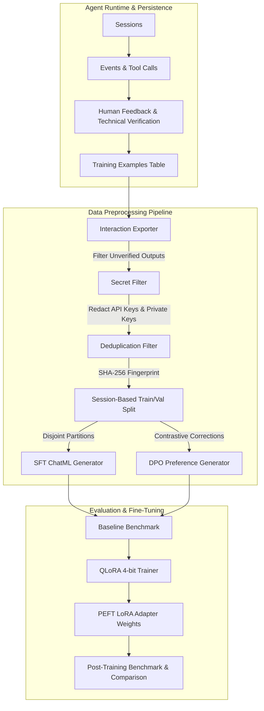

# Evolve Machine Learning Pipeline

## 1. Overview & Architecture

The Evolve Machine Learning Pipeline bridges autonomous agent execution with model continuous self-improvement. As Evolve solves software engineering tasks, every user instruction, agent reasoning step, tool call, execution result, test failure, and human feedback rating is captured in Evolve's local SQLite persistence store.

The ML pipeline transforms verified interactions into high-quality training datasets for **Supervised Fine-Tuning (SFT)** and **Direct Preference Optimization (DPO)**, fine-tunes local adapter weights using **QLoRA (4-bit Parameter-Efficient Fine-Tuning)**, and systematically benchmarks baseline vs fine-tuned performance.



---

## 2. Fundamental ML Concepts

### 2.1 Model Weights

Neural network parameters (floating-point tensors) organized in matrices across transformer layers (self-attention projections $W_q, W_k, W_v, W_o$ and feed-forward networks $W_{\text{gate}}, W_{\text{up}}, W_{\text{down}}$). During pre-training, weights absorb statistical regularities of code and natural language. During inference, weights remain immutable. During fine-tuning, weight adjustments encode task-specific agent behaviors and conventions.

### 2.2 Supervised Fine-Tuning (SFT)

SFT trains a pre-trained base model on curated $(x, y)$ input-output pairs using cross-entropy loss:
$$\mathcal{L}_{\text{SFT}}(\theta) = -\sum_{t=1}^{T} \log P_\theta(y_t \mid x, y_{<t})$$
In coding agents, SFT formats interactions into conversational turns (ChatML) where the assistant generates structured tool calls, file edits, and verified code implementations in response to developer prompts.

### 2.3 LoRA (Low-Rank Adaptation)

Full fine-tuning updates all $d \times k$ parameters of weight matrix $W_0$. For an 8B parameter model, this requires tens of gigabytes of GPU VRAM just for optimizer states. LoRA freezes $W_0$ and decomposes the weight update $\Delta W$ into two low-rank matrices $A$ and $B$:
$$W = W_0 + \Delta W = W_0 + \frac{\alpha}{r} (B \cdot A)$$
Where $W_0 \in \mathbb{R}^{d \times k}$, $B \in \mathbb{R}^{d \times r}$, $A \in \mathbb{R}^{r \times k}$, and rank $r \ll \min(d, k)$ (typically $r \in [8, 64]$).

- Only $A$ and $B$ receive gradients, reducing trainable parameters by $99\%+$.
- Scaling factor $\frac{\alpha}{r}$ stabilizes hyperparameter tuning across different ranks.
- At inference time, adapter weights can be merged back into $W_0$ with zero added latency.

### 2.4 QLoRA (Quantized Low-Rank Adaptation)

QLoRA makes fine-tuning possible on consumer GPUs (e.g. 8GB VRAM) by introducing three innovations:

1. **NF4 (NormalFloat 4) Quantization**: An information-theoretically optimal quantile quantization data type for normally distributed neural network weights.
2. **Double Quantization**: Quantizes the quantization constants themselves, saving $\approx 0.37$ bits per parameter.
3. **Paged Optimizers**: Uses CUDA Unified Memory to automatically page optimizer states to CPU RAM during memory spikes, preventing out-of-memory (OOM) crashes.

### 2.5 Tokenization

LLMs process discrete integer token IDs rather than raw Unicode strings. A tokenizer (e.g. Byte-Pair Encoding or SentencePiece) segments text into subword units:

- Common code structures (`def `, `import `, `return `) map to single tokens.
- Specialized whitespace and indentation characters are preserved exactly.
- Context window boundaries (e.g. 2048 or 4096 tokens) constrain input sequences.

### 2.6 Direct Preference Optimization (DPO)

Traditional RLHF requires training a separate reward model and running unstable PPO (Proximal Policy Optimization) reinforcement learning. DPO mathematically derives the policy loss directly from the Bradley-Terry preference model:
$$\mathcal{L}_{\text{DPO}}(\theta; \pi_{\text{ref}}) = -\mathbb{E}_{(x, y_w, y_l)} \left[ \log \sigma \left( \beta \log \frac{\pi_\theta(y_w \mid x)}{\pi_{\text{ref}}(y_w \mid x)} - \beta \log \frac{\pi_\theta(y_l \mid x)}{\pi_{\text{ref}}(y_l \mid x)} \right) \right]$$
Where $y_w$ is the chosen (preferred / corrected) response, $y_l$ is the rejected (flawed) response, and $\pi_{\text{ref}}$ is the frozen reference policy. DPO aligns the model without training a separate reward network.

### 2.7 Training vs Inference

| Characteristic       | Training                                                                               | Inference                                            |
| -------------------- | -------------------------------------------------------------------------------------- | ---------------------------------------------------- |
| **Computation**      | Forward pass + Backward pass (Autograd) + Optimizer step                               | Forward pass only (no gradients)                     |
| **Memory Footprint** | Model weights + Activations + Gradients + Optimizer states (AdamW: $8 \times$ weights) | Model weights + KV Cache                             |
| **Quantization**     | QLoRA 4-bit base + 16-bit adapters, bf16 gradients                                     | 4-bit / 8-bit / 16-bit static execution              |
| **Output**           | Updated weight checkpoints / PEFT adapter safetensors                                  | Next-token probability distribution & generated text |

---

## 3. The Lifecycle: From Interaction to Model Adapter

### Step 1: Interaction Persistence & Technical Verification

During agent execution, Evolve records sessions, events, tool calls, and feedback.

> [!IMPORTANT]
> **Safety Invariant**: _Never train directly on unreviewed external model outputs._
> Unreviewed model outputs may contain subtle hallucinations, security vulnerabilities, or logic bugs. An interaction is only accepted into the training set if:
>
> 1. It is marked `is_technically_correct == 1` via automated test verification or explicit human approval; OR
> 2. The human user provided an explicit written `correction`.

### Step 2: Data Extraction (`exporter.py`)

`SQLiteInteractionExporter` reads from `.evolve/evolve.db`, extracting `training_examples`, `sessions`, `events`, and `feedback`. Unverified interactions without corrections are filtered out.

### Step 3: Secret Filtering & Deduplication (`filters.py`)

- **`SecretFilter`**: Redacts private RSA/SSH keys, OpenAI API keys (`sk-...`), GitHub personal access tokens (`ghp_...`), AWS keys (`AKIA...`), Hugging Face tokens (`hf_...`), generic authorization headers, and database URIs.
- **`DeduplicationFilter`**: Computes SHA-256 digests over normalized prompt and response pairs, eliminating duplicate examples that could cause overfitting.

### Step 4: Disjoint Train/Validation Splitting (`preprocessing.py`)

To prevent data leakage, dataset splitting is performed strictly by `session_id`. If a multi-turn conversation or task has multiple interactions, all interactions from that session belong exclusively to either the training set or the validation set.

### Step 5: Dataset Formatting (`sft.py` and `preference.py`)

- **SFT (`sft.py`)**: Converts examples into ChatML format:
  ```json
  {
    "id": "ex_0_sess_1",
    "session_id": "sess_1",
    "messages": [
      {
        "role": "system",
        "content": "You are Evolve, an expert autonomous software engineering AI agent."
      },
      { "role": "user", "content": "Implement safe division" },
      { "role": "assistant", "content": "def div(a, b): return a / b if b != 0 else 0" }
    ]
  }
  ```
- **DPO (`preference.py`)**: When a human provides a correction for a flawed model output, a contrastive triplet is generated:
  ```json
  {
    "prompt": "Implement safe division",
    "chosen": "def div(a, b): return a / b if b != 0 else 0",
    "rejected": "def div(a, b): return a / b"
  }
  ```

### Step 6: Baseline Evaluation (`eval.py`)

Before launching fine-tuning, `ModelEvaluator` establishes a baseline benchmark on the validation split:

- **Syntax Validity Rate**: Extracts code blocks and parses them with Python `ast.parse` and bracket matching.
- **Perplexity & Loss**: Computes cross-entropy loss over validation sequences.

### Step 7: QLoRA Fine-Tuning (`train.py`)

`SFTModelTrainer` configures:

- Base model: `Qwen/Qwen2.5-Coder-0.5B-Instruct`
- 4-bit NF4 quantization (`BitsAndBytesConfig`)
- LoRA rank $r=16$, $\alpha=32$, dropout $0.05$ targeting attention projections and MLP layers.
- Optimizer: AdamW with cosine learning rate schedule and warmup.
- Output: LoRA adapter weights saved in `models/evolve-coder-adapter`.

---

## 4. Verification & Testing

The Python ML pipeline is thoroughly tested with unit tests covering all components:

- `test_filters.py`: Verifies redaction of keys/secrets and SHA-256 deduplication.
- `test_exporter.py`: Verifies technical correctness gating and SQLite extraction.
- `test_preprocessing.py`: Verifies secret redaction and disjoint train/val splitting.
- `test_sft.py`: Verifies ChatML structure and role invariants.
- `test_preference.py`: Verifies DPO triplet creation and contrastive invariants.
- `test_eval.py`: Verifies Python AST validation and syntax scoring.
- `test_pipeline.py`: Verifies end-to-end pipeline execution and adapter export.

Run all tests via:

```bash
pnpm --filter @evolve/ml test
```
