# Repository Intelligence Architecture

Evolve v0.4 introduces **Repository Intelligence**: an autonomous, local-first code analysis and retrieval subsystem that empowers the agent to inspect, index, and retrieve relevant source code from software repositories before making coding decisions.

---

## 1. High-Level Architecture Pipeline

```mermaid
flowchart TD
    subgraph Discovery ["1. Repository Discovery (@evolve/indexer/discovery)"]
        A[Project Root Discovery] --> B[Git & Branch Status]
        B --> C[Exclusion Filter & .gitignore Engine]
        C --> D[Multi-Ecosystem Profiler]
        D --> E[Manifest & Monorepo Parser]
        E --> F[Structured Overview Formatter]
    end

    subgraph Parsing ["2. Pluggable AST Parsing (@evolve/indexer/parsers)"]
        G[TypeScript Compiler API] --> H[Symbols: Functions, Classes, Types]
        I[Generic Multi-Lang Parser] --> H
        H --> J[Import & Dependency Graph Extractor]
    end

    subgraph Indexing ["3. SQLite Incremental Indexer (@evolve/indexer/indexer)"]
        K[File Stat: mtime + size] --> L{Matches DB?}
        L -- Yes --> M[Skip / Cache Hit]
        L -- No --> N[SHA-256 Content Hash Check]
        N -- Modified --> O[Parse AST & Extract Symbols]
        O --> P[(SQLite Tables & FTS5 Virtual Index)]
        K -- Pruned --> Q[Cascade Deletion]
    end

    subgraph Search ["4. Search & Retrieval Engine (@evolve/indexer/search)"]
        R[Query] --> S[FTS5 BM25 Code Search]
        R --> T[Symbol Declaration Search]
        R --> U[Reference & Usage Tracer]
        S & T & U --> V[Dependency Graph Proximity Expansion]
        V --> W[Token-Budgeted Context Retriever]
    end

    subgraph AgentTools ["5. Agent Tools (@evolve/agent/tools)"]
        W --> T1[inspect_project]
        W --> T2[get_project_structure]
        W --> T3[find_symbol]
        W --> T4[find_references]
        W --> T5[get_dependencies]
        W --> T6[get_related_files]
        W --> T7[search_code / read_file]
    end
```

---

## 2. Subsystem Components

### 2.1 Repository Discovery (`ProjectScanner`)
- **Root Detection**: Traverses upwards looking for project markers (`.git`, `package.json`, `pnpm-workspace.yaml`, `Cargo.toml`, `pyproject.toml`, `go.mod`, `pom.xml`, `build.gradle`, `pubspec.yaml`).
- **Ignore & Exclusion Engine**:
  - Respects `.gitignore` rules in repository root and subdirectories.
  - Automatically prunes build directories (`dist/`, `build/`, `.next/`, `target/`, `bin/`, `obj/`, `coverage/`).
  - Blocks sensitive credentials (`.env*`, `*.pem`, `*.key`, `id_rsa*`, `credentials.json`).
  - Ignores binary formats (images, audio, video, archives, compiled binaries, sqlite databases).
- **Ecosystem & Framework Profiling**:
  - Languages: TypeScript, JavaScript, Python, Rust, Go, Java, C/C++, C#, Dart/Flutter.
  - Frameworks: Next.js, React, Express, Fastify, NestJS, FastAPI, Django, Flask, PyTorch, Axum, Actix, Tokio, Gin, Flutter.
  - Databases & ORMs: SQLite / better-sqlite3, Prisma, Drizzle ORM, MongoDB, PostgreSQL, SQLAlchemy.
  - Testing: Vitest, Jest, Pytest, Playwright.
  - Package Managers: pnpm, npm, yarn, bun, cargo, go, pip, poetry, maven, gradle, pub.
  - Monorepo Detection: pnpm workspaces, npm/yarn workspaces, Cargo workspaces, Go work.

### 2.2 AST Parsing & Symbol Extraction (`LanguageParser`)
A pluggable parser architecture turns flat source text into structured symbol trees without requiring full language servers:
1. **`TypeScriptAstParser`**:
   - Uses the official TypeScript compiler API (`ts.createSourceFile`).
   - Extracts function declarations, arrow functions assigned to variables, class definitions, interfaces, type aliases, enums, and class methods.
   - Preserves exact 1-based start and end line spans and function signatures.
   - Extracts module dependencies from import declarations (`import { a } from './b'`, `import * as c from 'c'`).
   - Extracts exported identifiers (`export const`, `export default`, `export { x }`).
2. **`GenericRegexParser`**:
   - Fast, robust regex parser for non-JS/TS codebases.
   - Python: `def`, `class`, `import`, `from ... import`.
   - Rust: `fn`, `struct`, `enum`, `trait`, `impl`, `use`.
   - Go: `func`, `type ... struct`, `type ... interface`, `import`.
   - Java / C++: `class`, `interface`, `#include`.

### 2.3 Incremental Indexing (`RepositoryIndexer`)
Indexes code into a local SQLite database (`.evolve/evolve.db`):
- **Schema Migration `003_repo_index`**:
  - `repo_files`: Stores file path, content SHA-256 hash, modification time (`mtime`), size, and language.
  - `repo_symbols`: Stores extracted symbol names, kinds, line spans, signatures, and docstrings.
  - `repo_dependencies`: Stores imported modules, imported symbol names, and external/internal flags.
  - `repo_code_fts`: SQLite FTS5 virtual table tokenized with `porter unicode61` for sub-millisecond keyword search.
- **Incremental Cache Validation**:
  - Fast check: If `stat.mtime` and `stat.size` match existing DB records, the file is skipped in microseconds.
  - Hash check: If `mtime` changed but SHA-256 hash is unchanged, updates `mtime` and skips re-parsing.
  - Modified / Added: Re-parses AST, cascades symbol updates, and updates FTS5 in a single atomic transaction.
  - Deletions: Cascades removals from SQLite and FTS when files are deleted on disk.

### 2.4 Code & Symbol Search Engine
- **`CodeSearchEngine`**: High-speed full-text search using FTS5 BM25 ranking, resolving exact line numbers and match previews. Falls back to regex when specified.
- **`SymbolSearchEngine`**: Looks up symbol definitions by name prefix, exact match, or kind (`findSymbols('AuthService')`).
- **`DependencyGraphEngine`**: Traces module relationships:
  - `getDependencies(path)`: Lists external libraries, internal imports, and reverse importers.
  - `getRelatedFiles(path)`: Discovers connected files using dependency graph proximity.

### 2.5 Context Retrieval Engine (`ContextRetriever`)
Builds compact, token-budgeted context excerpts for the LLM:
1. Extracts technical terms and stems from user query (e.g. `authentication` $\to$ `auth`).
2. Multi-signal scoring:
   - Path match: +15 points
   - Symbol match: +12 points
   - FTS5 keyword hit: +8 points
   - Dependency graph 1st-degree proximity: +4 points
3. Ranks candidate files and assembles formatted excerpts honoring token budgets (default: 4,000 tokens) with line numbers and truncation indicators.

---

## 3. Tool Reference

The agent runtime exposes 15 tools in `ToolRegistry`:

| Tool | Parameters | Description |
| :--- | :--- | :--- |
| `inspect_project` | `{ targetPath?: string }` | Scans workspace root to detect languages, frameworks, manifests, and architecture. |
| `get_project_structure` | `{ maxDepth?: number }` | Returns high-level directory hierarchy, config files, and documentation. |
| `find_symbol` | `{ name: string, kind?: string, exactMatch?: boolean }` | Locates function, class, interface, or type declarations with line numbers and signatures. |
| `find_references` | `{ symbol: string }` | Locates all call sites, usages, and import statements of a symbol across files. |
| `get_dependencies` | `{ path: string }` | Lists external libraries, internal modules, and reverse importers for a file. |
| `get_related_files` | `{ path: string }` | Finds files connected through import/export relationships and module boundaries. |
| `read_file` | `{ path: string, startLine?: number, endLine?: number }` | Reads file text with optional line-range slicing. Blocks sensitive files. |
| `list_files` | `{ path?: string, recursive?: boolean, maxDepth?: number }` | Lists workspace files, strictly respecting `.gitignore` and exclusion policies. |
| `search_code` | `{ query: string, path?: string, isRegex?: boolean }` | Fast code search using SQLite FTS5 index with line numbers. |
| `write_file` | `{ path: string, content: string }` | Creates or overwrites a file. *(Requires approval)* |
| `edit_file` | `{ path: string, target: string, replacement: string }` | Performs atomic find-and-replace on an existing file. *(Requires approval)* |
| `run_command` | `{ command: string, timeoutMs?: number }` | Executes shell commands inside the workspace. *(Requires approval)* |
| `run_tests` | `{ testCommand?: string }` | Executes test runner and parses structured results. *(Requires approval)* |
| `git_status` | `{}` | Returns git branch, modified files, and staged status. |
| `git_diff` | `{ staged?: boolean, path?: string }` | Inspects working copy diffs. |

---

## 4. Security & Path Protection

All repository intelligence tools strictly enforce security boundaries:
- **Path Traversal Protection**: Every input path is resolved and checked against `assertSafePath`. Attempts to escape the workspace (`../../`) throw immediate security errors before accessing the filesystem or database.
- **Credential Protection**: Files matching `.env*`, `*.pem`, `*.key`, `id_rsa*`, or `credentials.json` are excluded from indexing, file listing, and content reading.
- **Resource Limits**: Configurable file size limits (default 2MB) and token ceilings (default 4,000 tokens) prevent memory exhaustion on large repositories.
