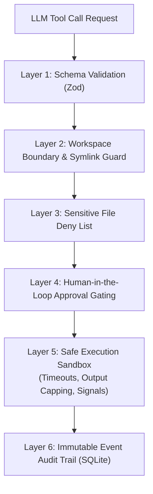

# Security & Sandboxing Architecture

## 1. Threat Model

An autonomous coding agent interprets LLM reasoning and performs actions in local environments: reading files, modifying code, executing shell commands, and invoking VCS tools. Without rigorous boundaries, an agent introduces severe security risks:

1. **Path Traversal (CWE-22)**: Reading or overwriting system files outside the designated workspace (e.g., `../../etc/shadow`).
2. **Symlink Escape**: Following symlinks that point outside the project directory to read sensitive host files.
3. **Credential & Secret Exfiltration**: Reading `.env` files, SSH keys (`~/.ssh/id_rsa`), or cloud credentials and leaking them into LLM prompt histories or log files.
4. **Arbitrary Code Execution & Shell Injection**: Executing malicious commands injected via unescaped shell strings or subshell expansions (`$(...)`, `;`, `&&`).
5. **Resource Exhaustion & Denial of Service**: Unbounded loops producing infinite stdout/stderr streams or zombie child processes exhausting system memory and file descriptors.
6. **Git Argument Injection**: Exploiting CLI options like `--upload-pack` or `--output` via unsanitized file paths.

---

## 2. Multi-Layer Defense-in-Depth Architecture



| Security Layer            | Enforced Controls                                                                                                      | Failure Behavior                                                    |
| :------------------------ | :--------------------------------------------------------------------------------------------------------------------- | :------------------------------------------------------------------ |
| **1. Input Validation**   | Strict Zod schemas validating types, bounds, and string constraints                                                    | Returns validation error in tool result; halts execution            |
| **2. Workspace Boundary** | Lexical (`path.resolve`, `path.relative`) and canonical (`fs.realpathSync`) checks                                     | Throws `PathTraversalError` or `SecurityError`                      |
| **3. Sensitive Files**    | Regex matching against `.env*`, `.git/config`, SSH keys, certificates, credentials                                     | Throws `SecurityError` ("Access to sensitive file is blocked")      |
| **4. Approval Gating**    | Async `ToolApprovalHandler` invoked for destructive operations (`write_file`, `edit_file`, `run_command`, `run_tests`) | Returns `'APPROVAL_DENIED'` without modifying disk                  |
| **5. Process Limits**     | Execution timeouts (default 30s/60s), stdout/stderr output buffer caps (50KB), closed stdin                            | Sends `SIGTERM` followed by `SIGKILL`; truncates stream with notice |
| **6. Git Isolation**      | Direct binary execution (`execFile`) bypassing shell, `-C <workspace>` scoping, and `--` argument separators           | Prevents flag injection and subshell execution                      |

---

## 3. Filesystem Sandboxing & Path Traversal Guards

All filesystem tools (`read_file`, `write_file`, `edit_file`, `list_files`, `search_code`) route paths through `assertSafePath(targetPath, workspaceRoot)`:

```typescript
export function assertSafePath(targetPath: string, workspaceRoot: string): string {
  // 1. Lexical traversal check
  const safePath = assertPathInsideWorkspace(targetPath, workspaceRoot);

  // 2. Sensitive file pattern matching
  if (isSensitiveFile(safePath) || isSensitiveFile(targetPath)) {
    throw new SecurityError(`Access to sensitive file is blocked: ${targetPath}`);
  }

  // 3. Symlink target verification
  if (fs.existsSync(safePath)) {
    const realTarget = fs.realpathSync(safePath);
    const realRoot = fs.realpathSync(workspaceRoot);
    const relToRoot = path.relative(realRoot, realTarget);

    if (relToRoot.startsWith('..') || path.isAbsolute(relToRoot)) {
      throw new SecurityError(`Symlink path escapes workspace root: ${targetPath}`);
    }
  }

  return safePath;
}
```

### Protected Sensitive Patterns

The following files are unconditionally blocked from read, write, and edit operations:

- `.env`, `.env.*` (environment secrets)
- `.git/config`, `.git/credentials` (repository credentials and hooks)
- `id_rsa`, `id_ed25519`, `id_ecdsa`, `id_dsa`, and `.pub` keys
- `*.pem`, `*.key`, `*.pfx`, `*.p12`, `*.pkcs12` (TLS certificates and private keys)
- `.netrc`, `.npmrc`, `.pypirc` (package manager credentials)
- `credentials.json`, `secrets.json`, `service-account*.json` (cloud API keys)

---

## 4. Subprocess Execution & Shell Injection Defense

Commands invoked by `run_command` and `run_tests` use `child_process.spawn` with strict boundary controls:

1. **Closed Stdin**: `child.stdin.end()` is invoked immediately after spawning to prevent processes from hanging on interactive prompts (e.g. `[y/N]` prompts).
2. **Environment Sanitization**: Sets `CI: 'true'` to instruct CLI tools (like package managers and test runners) to operate non-interactively.
3. **Two-Stage Timeout Escalation**:
   - At timeout expiration (e.g. 30,000ms), sends `SIGTERM` to allow graceful termination.
   - If the process is still running after a 1,000ms grace period, sends `SIGKILL` to force kernel-level termination.
4. **Output Stream Capping**:
   - `stdout` and `stderr` buffers are capped at a configurable byte limit (default: 50,000 characters).
   - If a command generates megabytes of logs, the buffer is trimmed and a truncation notice is appended, preventing memory exhaustion and LLM context window blowup.
5. **AbortSignal Integration**: Subprocesses listen to `signal.addEventListener('abort')` to immediately terminate if the user cancels execution via the CLI (`Ctrl+C`).

---

## 5. Safe Git Execution

Git operations (`git_status`, `git_diff`) use `execFile('git', args)` rather than shell execution:

```typescript
// Direct binary execution: no shell interpolation (/bin/sh) is invoked
const fullArgs = ['-C', workspaceRoot, ...args];
execFile('git', fullArgs, { timeout: 15_000, env: { GIT_TERMINAL_PROMPT: '0' } }, ...);
```

### Argument Injection Protection

If a user or model passes a filename beginning with dashes (e.g. `--upload-pack`), Git could interpret it as a flag. Evolve enforces the `--` operand separator:

```typescript
const diffArgs = ['diff', ...(staged ? ['--cached'] : []), '--', targetPath];
```

This forces Git to treat `targetPath` strictly as a file path, completely preventing flag injection.

---

## 6. Human-in-the-Loop Approval Gating

Destructive actions require explicit verification via `ToolApprovalHandler`:

- `write_file`: Overwriting existing files or creating new files.
- `edit_file`: Modifying code files.
- `run_command`: Executing arbitrary shell commands.
- `run_tests`: Invoking test runners.

If approval is rejected or denied, the tool immediately halts and returns a clean `'APPROVAL_DENIED'` result to the model, preventing any changes to disk.
